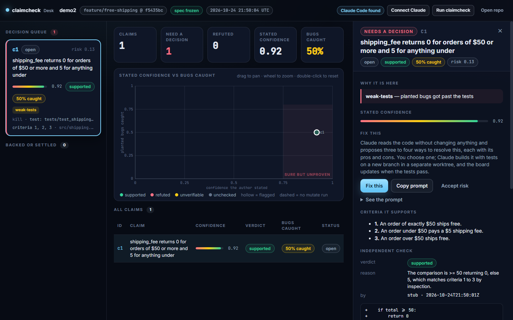
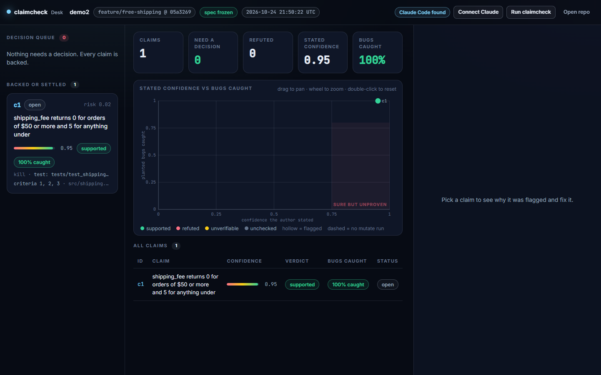

# claimcheck

@author Patrick Finazzo

**A verification ledger for AI-written code.** An AI agent says its change works. claimcheck checks that claim three independent ways, writes the result to an append-only ledger, and shows you which claims are backed and which are only confident.

Setup is one command, and it walks you through everything:

```bash
claimcheck init
```


## Contents

- [How it works](#how-it-works)
- [Install](#install)
- [Setup: `claimcheck init`](#setup-claimcheck-init)
- [Writing the spec with Claude](#writing-the-spec-with-claude)
- [What is sent to Claude](#what-is-sent-to-claude)
- [Using it day to day](#using-it-day-to-day)
- [Example: the weak-test catch](#example-the-weak-test-catch)
- [Using it on a team](#using-it-on-a-team)
- [The Desk app](#the-desk-app)
- [Writing good claims](#writing-good-claims)
- [Reference](#reference)
- [Troubleshooting](#troubleshooting)
- [Limits, stated plainly](#limits-stated-plainly)
- [Development](#development)

## How it works

Every change carries three checks that its author cannot influence.

1. **Criteria frozen before the code exists.** Acceptance criteria are hashed into a lock file. Anything added or edited afterwards is refused.
2. **A second opinion that cannot see the author's confidence.** A separate model reads only the frozen criteria, the diff and the bare claims. It never sees how sure the author was or what evidence the author cited.
3. **Planted bugs.** claimcheck breaks the new code on purpose, one small change at a time, and reruns your tests. The share of planted bugs your tests catch is printed next to the confidence the author stated.

```
 spec.md ──freeze──▶ spec.lock          criteria, hashed, before any code
                         │
 agent writes code ──▶ claims.yaml      claim + confidence + what would prove it wrong
                         │
       claimcheck run ───┼──▶ checker      blind verdict per claim: SUPPORTED / REFUTED / UNVERIFIABLE
                         └──▶ mutate       plant bugs in the added lines, rerun your tests, count catches
                                │
                                ▼
                         ledger.jsonl      one line per claim, append-only
```

## Install

Python 3.11 or newer, and a git repository. claimcheck is not on PyPI yet, so install it from a clone:

```bash
git clone https://github.com/pfinazzo/claimcheck.git
pip install -e "./claimcheck[claude]"
```

You do not need an API key. If you have Claude Code installed and signed in, claimcheck uses that sign-in. An `ANTHROPIC_API_KEY` in your environment is used instead when it is set. Drop `[claude]` if you only want the sign-in route or the offline stub.

## Setup: `claimcheck init`

Run it from the root of the repository you want to protect. It is a short guided tour, one screen at a time. Press Enter to move on, `m` for more detail on a screen, `s` to skip the explanation. Nothing is committed until the last step, and you can stop with Ctrl+C at any point: whatever finished is kept, and running `init` again continues.

### 1. The problem


A confident claim is shown next to the question the rest of the tool answers: do the tests actually back it?

### 2. Three checks


The three checks, with a small animated example of a planted bug: the comparison `>=` becomes `>`, the tests still pass (survived), a boundary test is added, and the same bug is now caught (killed).

### 3. Set up this repo


This is the part that changes your repo. The first step is always the same: **secrets first**. Before anything else is written, `init` creates `.gitignore` if it is missing and makes sure `.env` and key files are ignored. If a secret file is already committed, it tells you, because ignoring a file does not remove it from history.

Then, in order:

| Step | What it does |
| --- | --- |
| Secrets | Creates `.gitignore` if missing. Adds `.env`, `.env.*` (but not `.env.example`), `*.pem`, `*.key`, `*.p12`, `id_rsa*`, `id_ed25519*`. Warns about any such file that is already tracked |
| Config | Writes `.claimcheck/config.toml`. Detects your stack (Node, Python, Go, Rust, Maven, Gradle) and fills in the test command and the list of paths that are not product code. You can type a different test command when asked |
| Commit hook | Installs a pre-commit hook where git actually looks for it. That is the right place even with `core.hooksPath` (husky and similar) or in a linked worktree. An existing hook is kept, and the claimcheck line goes in before a trailing `exit` |
| `.gitignore` | Ignores claimcheck's scratch output (`runs/`, the mutation lock and backup, the app state, the draft) |
| Agent instructions | Adds the claimcheck rules to `CLAUDE.md`, `.claude/CLAUDE.md` and `AGENTS.md`, whichever exist. If none exist you are asked whether to create `CLAUDE.md`. The block sits between two marker comments, so running `init` again updates it in place and never duplicates it |
| CI workflow | Asked once, default no. A GitHub Actions workflow that runs claimcheck on every pull request |

You never copy a block into an instructions file or edit `.gitignore` by hand. The block `init` adds is in [`src/claimcheck/agentdocs.py`](src/claimcheck/agentdocs.py); it tells the agent to check the spec, keep `claims.yaml` current with honest confidence, and run `claimcheck run` before it finishes.

### 4. Connect Claude


claimcheck picks a connection on its own: your API key if `ANTHROPIC_API_KEY` is set, otherwise your Claude Code sign-in. The screen says which one, and says what Claude will see (see [What is sent to Claude](#what-is-sent-to-claude)). If neither is available you are told how to fix it, and setup finishes anyway. You can write the spec by hand in `.claimcheck/spec.md`.

### 5. Your first spec


You say what you want built in a sentence or two, and the conversation starts (details in the next section). When you accept the criteria, claimcheck freezes them and commits them on a new task branch, then shows what to do next. You can press Enter at the goal prompt to skip this and do it later with `claimcheck spec draft`.

### Running without the tour

| Command | What you get |
| --- | --- |
| `claimcheck init` | The guided tour, when run in a terminal |
| `claimcheck init --no-tour` | Straight to setup, still guided |
| `claimcheck init --no-animation` | The guided flow without animation. Also automatic when `NO_COLOR` or `CI` is set, or the terminal is `dumb` |
| `claimcheck init --yes` | No prompts, no animation: does the setup and prints a summary. This is what scripts and CI get automatically when there is no terminal |
| `claimcheck init --json` | No prompts. Prints what was done as one JSON document, for tools |
| `claimcheck init --goal "…"` | Starts the spec conversation with that goal |
| `claimcheck init --ci github` | Also writes the CI workflow |
| `claimcheck init --agent-doc claude` | Creates `CLAUDE.md` (or `agents` for `AGENTS.md`) when neither exists |

`init` is safe to run twice. It never overwrites a file that exists. `claimcheck status` tells you where a repo is: whether it is set up, whether a spec is frozen, whether the hook is in place.

## Writing the spec with Claude

`claimcheck spec draft` turns a goal into acceptance criteria through a back-and-forth. It is the same conversation the setup tour ends with, and you can run it any time you start a new task.

```bash
claimcheck spec draft
```

Each round, Claude:

- asks up to five questions, each with a short reason it matters ("it decides which side of the boundary criterion 1 lands on"),
- shows the criteria as they stand, each with a one-line way to check it,
- flags contradictions and assumptions it had to make.

You answer in plain text. A blank answer means "you decide", and Claude says what it assumed. You can also edit the draft yourself at any point, and Claude keeps your wording:

| Type | Does |
| --- | --- |
| Enter | Keep going: Claude folds in your answers and asks what is left. When nothing is left, Enter saves |
| `e 2` | Rewrite criterion 2 |
| `c 2` | Rewrite how criterion 2 is checked |
| `d 2` | Delete criterion 2 |
| `a` | Add a criterion |
| `o` | Add an out-of-scope line |
| `save` | Write the spec and stop |
| `quit` | Leave without writing. Your answers are kept: `claimcheck spec draft --resume` continues |
| `?` | Show this list |

Local warnings appear under a criterion when it uses vague words ("fast", "properly"), names no observable behavior, runs to two ideas, or duplicates another. They are advice, not rules.

At the end claimcheck writes `.claimcheck/spec.md`, freezes it, switches to a new branch named from your goal (for example `task/add-free-shipping-over-50`, only when you were on the base branch) and commits the spec, the lock and the files `init` changed. Nothing is pushed.

| Option | Meaning |
| --- | --- |
| `--goal "…"` | Skip the goal prompt |
| `--resume` | Continue the saved conversation |
| `--max-rounds N` | Stop asking after N rounds (default 6) |
| `--no-freeze` | Write `spec.md` only |
| `--no-branch` / `--branch NAME` | Commit on the current branch, or on a branch with this name |
| `--yes` | Freeze and commit without asking |
| `--provider auto\|claude\|claude-cli\|stub` | Which model connection. `stub` is offline and gives placeholder questions |

The result is a plain file you can read and edit before it is frozen:

```markdown
# Acceptance criteria

Goal: Orders of $50 or more should ship free, and everything else pays a $5 flat fee.

- [ ] 1. An order whose subtotal is exactly $50.00 pays $0 shipping.
  - Check: shipping fee for a $50.00 subtotal is 0
- [ ] 2. An order whose subtotal is under $50.00 pays $5 shipping.
  - Check: shipping fee for a $49.99 subtotal is 5

## Out of scope

- International shipping rates
```

If you would rather write it by hand, edit `.claimcheck/spec.md` (lines in the form `- [ ] 1. text`, numbered from 1) and run `claimcheck spec freeze`.

Freezing a second task in the same repo works the way you would expect: only changed code blocks a new freeze, so editing the spec on a fresh branch is fine.

## What is sent to Claude

Anything that leaves your machine is filtered first. The filter runs where each prompt is built and again at the connection itself, so a mistake in one place does not get through the other.

| Layer | What it does |
| --- | --- |
| Secret files | Files that look like secret stores are never read into a prompt, and their names are not listed. That covers `.env` and `.env.*`, private keys and certificates (`*.pem`, `*.key`, `*.p12`, `*.jks`), `id_rsa` and friends, `.npmrc`, `.pypirc`, `.netrc`, credentials and secrets files and folders, service-account JSON, Terraform state and variables, kubeconfig, and anything under `.ssh`, `.aws`, `.kube` or `.docker` |
| Secret values | In every other file, text that looks like a secret is replaced with `[REDACTED:kind]` before it is sent: API keys for Anthropic, OpenAI, AWS, GitHub, GitLab, Slack, Stripe, Google, npm, Twilio and SendGrid, JWTs, bearer tokens, private key blocks, passwords in URLs, assignments to names like `password`, `token` or `api_key`, and long random strings. Ordinary code such as `password = get_password()` is left alone |
| Size cap | At most 40,000 characters per file and 250,000 per request |

What each feature sends:

| Feature | Sent | Not sent |
| --- | --- | --- |
| Spec conversation | Your goal, your answers, your edits to the criteria, the repo's file names | Secret-looking file names, file contents |
| Claim check | The frozen criteria, the claims (text and files), the diff under test | The author's confidence and evidence, anything in `.claimcheck/`, secret files, secret values |
| Planted bugs | Nothing. This runs your tests locally | Everything |

Two more protections follow from this:

- You can see what was held back. The result of `claimcheck check` has a `sent` section listing the withheld files, how many values were redacted and of what kind, and whether anything was cut for size. It never contains the secret itself.
- When Claude runs through your Claude Code sign-in, claimcheck starts it with its file, shell and web tools switched off and from a temporary folder, so it works only from the text it was handed.

This is a safety net, not a guarantee. The patterns lean toward redacting too much, but a secret in an unusual format can slip past, and a key that was ever committed should be rotated whatever claimcheck does. `init` closes the usual hole first (`.env` ignored, committed secrets reported), and the Desk app applies the same filter and a deny list for Claude Code's file tools (see [The Desk app](#the-desk-app)). The Python and Desk filters are tested against the same set of cases, in [`tests/fixtures/secret_cases.json`](tests/fixtures/secret_cases.json), so they cannot drift apart.

## Using it day to day

After setup, a task looks like this.

1. **Spec.** `claimcheck spec draft` (or edit `spec.md` and run `claimcheck spec freeze`). The spec and lock are committed first, alone, on a task branch.
2. **Build.** Your coding agent works on the branch. It reads the claimcheck rules from `CLAUDE.md` or `AGENTS.md`. Each commit that changes code includes an updated `.claimcheck/claims.yaml`, and the commit hook refuses one that does not.
3. **Check.** `claimcheck run` verifies the lock, asks the blind checker about each claim, plants bugs and reruns your tests, then appends one ledger line per claim. It prints one JSON document and saves it under `.claimcheck/runs/`.
4. **Decide.** Look at the board (below), fix what is weak, accept a risk with a reason, or narrow a claim.
5. **Merge.** Commit `ledger.jsonl` with the merge so the history travels with the code.

## Example: the weak-test catch

A real run on a small demo project. The change adds free shipping for orders of $50 or more:

```python
def shipping_fee(total):
    """Orders of $50 or more ship free; everything else costs $5."""
    if total >= 50:
        return 0
    return 5
```

The author's tests cover a big order and a small order and nothing near the boundary. They pass, and the author states 0.92 confidence. When `claimcheck run` planted four bugs in `src/shipping.py`:

| Outcome | Planted bug | Real bug? |
| --- | --- | --- |
| survived | `if total >= 50:` became `if total >= 51:` | Yes, $50 would now pay shipping |
| survived | `if total >= 50:` became `if total > 50:` | Yes, $50 would now pay shipping |
| killed | `return 0` became `return 1` | Caught |
| killed | `return 5` became `return 6` | Caught |

The catch rate is 50%. Two real boundary bugs would have shipped with a green test run.



Pinning the boundary with three tests (exactly $50, just under, just over) catches all four:



*Both boards use the offline stand-in for the checker, so the "supported" verdict was scripted for the demo. The planted-bug numbers are real runs.*

Each run writes one JSON line per claim. This is the second run, trimmed:

```json
{
  "claim_id": "c1",
  "confidence": 0.95,
  "checker": { "provider": "stub", "verdict": "SUPPORTED", "reason": "The comparison is >= 50 returning 0, else 5.", "evidence": ["+    if total >= 50:"] },
  "mutation": { "catch_rate": 1.0, "killed": 4, "survived": 0, "timeout": 0, "total": 4 },
  "outcome": null
}
```

`outcome` stays `null` until something happens in the real world, such as a later bug fix that touches the same lines. The Desk app writes it when you resolve a claim.

## Using it on a team

| Role | Does | Owns |
| --- | --- | --- |
| **Requester** (human) | Runs `claimcheck spec draft` with the agent's task in mind and freezes it before work starts | `spec.md`, `spec.lock` |
| **Author** (agent or human) | Writes the code and the claims, with honest confidence | `claims.yaml`, the diff |
| **CI** | Runs `claimcheck run` on every pull request | The ledger line |
| **Reviewer** (human) | Reads the board, not the whole diff. Starts with the decision queue | The merge decision |

The author never grades their own work: someone else fixes the criteria, a model that cannot see the author's confidence gives the verdict, and your own tests produce the catch rate.

**What to commit and ignore.** Commit `spec.md`, `spec.lock`, `claims.yaml`, `config.toml` and `ledger.jsonl`. `init` already ignores the scratch output. The lock must be in git: the late-criteria check compares the lock's freeze time with the branch's first commit.

**CI.** `claimcheck init --ci github` writes `.github/workflows/claimcheck.yml`, which checks out full history, installs claimcheck and runs it against the pull request's base branch with `ANTHROPIC_API_KEY` from your repository secrets. It has not been run in a real pipeline yet, so treat it as a starting point. While the claimcheck repository is private, installing it from GitHub needs a token. The run edits files in the checkout while it plants bugs and then restores them, which is fine in a throwaway CI checkout.

**Turning it into a gate.** By default `mutate` only reports. To fail a build on weak tests, set a floor in `.claimcheck/config.toml`:

```toml
[mutate]
min_catch_rate = 0.7     # exit code 2 if fewer than 70% of planted bugs are caught
```

A sensible rollout: report only for the first couple of weeks, then set a floor a little under your median, then raise it as your tests improve. A REFUTED verdict already fails a run with exit code 2.

**Keep tests out of the mutation pool.** `init` puts your test folders on the `ignore` list for you, so planted bugs go into product code only. If you write the config by hand, add your test paths to `ignore`.

## The Desk app

Desk is an Electron app that reads a repo's `.claimcheck/ledger.jsonl` and shows it as a board: a decision queue of claims that need a person, and the claims that are backed. From a flagged claim, **Fix this** proposes three or four different ways to resolve it, builds the one you choose on a branch in a separate worktree, runs your tests, and records the outcome in the ledger. It lives in [`app/`](app/); see [`app/README.md`](app/README.md).

```bash
cd app
npm install
npm start
```

Node 20 or newer. Use **Open repo** to pick a project. Desk reads Claude Code's sign-in or an API key stored encrypted by your operating system, and applies the same secret filter as the command line before anything is sent. In Claude Code mode it denies the file tools access to credential files and blocks `cat`, `grep`, `curl`, `git push` and package installs.


*A claim the independent check refuted, with the reasons and the Fix this panel. The checker verdict here is from the offline stub.*

## Writing good claims

A claim is one sentence about the diff that could turn out false. Your agent writes these, following the rules `init` added to its instructions, but it helps to know what makes a good one.

- One checkable statement per claim. "`shipping_fee` returns 0 at exactly $50" is a claim. "The shipping feature works" is not.
- Cite the criteria it supports by number, and list every file it is about.
- State real confidence. If the code was not run, 0.6 is better than 0.95.
- A `kill_condition` that names something outside the claim: `test:` (a test id), `cmd:` (a command whose failure disproves it) or `obs:` (an observable value). One that only repeats the claim is rejected.

```yaml
version: 1
author: "claude-code"
base: "main"
claims:
  - id: c1
    claim: "shipping_fee returns 0 for orders of $50 or more and 5 for anything under"
    confidence: 0.92
    criteria: [1, 2, 3]
    files: ["src/shipping.py"]
    kill_condition: "test: tests/test_shipping.py::test_exactly_fifty_ships_free"
    verified_by:
      - "cmd: python -m pytest -q"
```

The validator rejects an `id` that is not lowercase letters, digits, `-` or `_`, empty text, a confidence outside 0 to 1, a bad `kill_condition`, an empty `verified_by` or `files`, fields of the wrong type, and criteria numbers that are not in the frozen lock (exit code 4). The commit hook requires, for every commit that changes code: an updated `claims.yaml` in the same commit, every file a claim lists to be in that commit, and every changed code file to be covered by some claim. Deletions count as changes.

## Reference

### Commands

```
claimcheck init                    guided setup: secrets, config, hook, .gitignore, agent notes, first spec
claimcheck status [--json]         where this repo is: set up, spec state, hook, branch
claimcheck spec draft              write the spec as a conversation with Claude
claimcheck spec freeze             hash the criteria into spec.lock
claimcheck spec verify             refuse if the spec drifted from the lock
claimcheck claims validate [path]  schema-check a claims file against the frozen criteria
claimcheck check                   independent verdict per claim
claimcheck mutate                  planted-bug catch rate on the changed lines
claimcheck run                     verify, validate, check, mutate, then append to the ledger
claimcheck hook pre-commit         what the installed git hook runs
```

Options shared by `check`, `mutate` and `run`:

| Option | Meaning |
| --- | --- |
| `--base REF` | The git ref the diff is measured against. Defaults to `base` in config |
| `--worktree` | Measure uncommitted changes, including new untracked files, instead of `base...HEAD` |
| `--provider auto\|claude\|claude-cli\|stub` | Which model connection (`check` and `run`) |
| `--model NAME` | Checker model (`check` and `run`) |
| `--test-cmd CMD` | Override the test command (`mutate` and `run`) |
| `--max-mutants N` | Cap the number of planted bugs (`mutate` and `run`) |
| `--seed N` | Make the sample of planted bugs repeatable |
| `--restore` | After a crashed `mutate`, put backed-up files back (see Troubleshooting) |

`check`, `mutate` and `run` print one JSON document to stdout and save it under `.claimcheck/runs/`. Messages for people go to stderr. The machine modes `init --json`, `status --json`, `spec draft --step` and `spec draft --finish` also print JSON, and on failure print `{"error": "...", "code": N}` and exit with that code.

### Providers

| Name | Uses |
| --- | --- |
| `auto` (default) | `ANTHROPIC_API_KEY` if set, otherwise your Claude Code sign-in |
| `claude` | The Anthropic API through the official SDK. Needs `claimcheck[claude]` and `ANTHROPIC_API_KEY` |
| `claude-cli` | Your Claude Code sign-in through the `claude` command, with all tools off. No API key |
| `stub` | Offline and deterministic. Every claim comes back UNVERIFIABLE, and the spec conversation gives placeholder questions. Good for trying the planted-bug half |

### Exit codes

| Code | Meaning |
| --- | --- |
| 0 | ok |
| 1 | other error, including an invalid config value |
| 2 | a claim was REFUTED, or the catch rate is under `min_catch_rate` |
| 3 | spec refusal: drifted from the lock, re-frozen after code changed, or a base ref that does not exist |
| 4 | claims file invalid, or the pre-commit hook rejected the commit |
| 5 | provider error, unknown provider, the baseline tests fail, or the working tree no longer matches the diff |
| 6 | a previous `mutate` left its lock behind, or `--restore` refused to overwrite a file |

### Files

| File | Purpose |
| --- | --- |
| `.claimcheck/spec.md` | Acceptance criteria as `- [ ] 1. text` lines |
| `.claimcheck/spec.lock` | JSON with a hash per criterion and the freeze time. The spec is hashed with line endings and any BOM normalised, so Windows and Linux agree |
| `.claimcheck/claims.yaml` | One entry per claim. See [`examples/claims.yaml`](examples/claims.yaml) |
| `.claimcheck/ledger.jsonl` | Append-only. See [`examples/ledger.jsonl`](examples/ledger.jsonl) |
| `.claimcheck/config.toml` | Settings. See [`examples/config.toml`](examples/config.toml) |
| `.claimcheck/setup.json` | The files `init` changed outside `.claimcheck/`, so the first commit includes them |

### Config

`init` writes this, with your detected test command and ignore list. A value of the wrong type is reported with the key's name instead of being silently ignored.

```toml
version = 1
base = "main"                       # the ref diffs are measured against
test_cmd = "npm test"               # rerun once per planted bug
ignore = ["*.md", "docs/**", ".claimcheck/**", "*.lock", ".gitignore", ".github/**", "tests/**"]
require_full_coverage = true        # the hook rejects uncovered code files (false = warn)

[checker]
provider = "auto"                   # "auto" | "claude" | "claude-cli" | "stub"
model = "claude-opus-5-5"

[mutate]
max_mutants = 50
timeout_s = 600                     # per test run; the whole process tree is killed on timeout
min_catch_rate = 0.0                # 0.0 reports only; raise it to gate
```

`ignore` uses glob matching where `*` and `**` both cross folders, and a leading `**/` also matches the top level.

### The four kinds of planted bug

Mutations are text-level and language-agnostic. They apply only to lines the diff adds, and never inside string literals.

| Kind | Example |
| --- | --- |
| Sign flip | `a + b` becomes `a - b`, and a unary minus is dropped |
| Off by one | `50` becomes `51` |
| Swapped arguments | `f(a, b)` becomes `f(b, a)` |
| Boundary shift | `>=` becomes `>`, and `<` becomes `<=` |

A mutant that does not compile counts as killed, because the test command fails.

## Troubleshooting

**`mutate.lock exists: a previous mutate run did not finish`**
`mutate` edits your files while it plants bugs, and it restores them even if it fails or you press Ctrl+C. The lock only stays behind if a restore itself failed. Run `claimcheck mutate --restore`. It puts back a file only when the file still holds the planted bug, and leaves any file you edited since. For those it prints which file and why, keeps the backup in `.claimcheck/mutate-backup/`, and exits 6. Sort it out by hand, then delete `.claimcheck/mutate.lock`.

**`... line 6 no longer matches the diff`**
You edited a file after committing it. `mutate` checks every planted bug against the current file before it touches anything, so nothing was changed. Commit or stash your edits and rerun.

**The commit is rejected with "staged paths with no claim covering them"**
A changed file is not listed in any claim's `files`. Add it to a claim, add it to `ignore` if it is not product code, or set `require_full_coverage = false` to warn instead.

**The commit is rejected with "files not in the staged diff"**
A claim lists a file that is not in this commit. Claims describe one commit's diff.

**`spec drifted from lock` (exit 3)**
`spec.md` no longer matches `spec.lock`. If you did not mean to change it, `git checkout .claimcheck/spec.md`. If the criterion really was wrong, start a new task on a new branch and freeze again.

**`refusing to re-freeze with an open diff`**
Code has already changed on this branch. Freezing a new spec is allowed until then, so start the next task on a fresh branch from the base.

**`base ref 'main' was not found`**
The branch named in `config.toml` does not exist here, often in a shallow CI clone. Fetch it (`git fetch origin main`), correct `base`, or pass `--base origin/main`.

**The baseline tests fail (exit 5)**
claimcheck runs your tests once before planting anything. If they fail on the unmodified code there is nothing to measure.

**Part of my diff was withheld from the checker**
That is the secret filter. The `sent` section of the check result names the files and counts the redactions. A file such as `.env` should not be committed at all: `claimcheck init` reports any that are.

**A planted bug survived but is not really a bug**
Some text changes do not change behavior. In a `clamp` function, `if x < lo` and `if x <= lo` return the same value at the boundary, so no test can tell them apart. Read the survivors, judge each, and accept the risk with a reason for the harmless ones.

**The hook does nothing**
Run `claimcheck status`. `init` installs the hook where git reads it, including with `core.hooksPath` and in worktrees. If you recreate your virtual environment, run `claimcheck init` again so the hook points at the new Python.

**Animations look wrong**
Use `--no-animation`, or set `NO_COLOR=1`. On older Windows consoles, Windows Terminal renders the box drawing and colors correctly.

## Limits, stated plainly

- **The checker only sees the diff.** Anything under `.claimcheck/` is removed from it, so it never sees your confidence, your evidence or earlier ledger lines. It cannot run your code. A claim that depends on runtime behavior comes back `UNVERIFIABLE`, which is honest but not a pass.
- **The catch rate measures your tests, not your code.** A high rate means your tests would notice small breakages in the lines you added. It does not mean the code is right.
- **Four kinds of planted bug.** Real bugs are more varied, so the rate is a floor for how responsive your tests are, not a full audit.
- **Equivalent mutants exist.** Some planted bugs do not change behavior and always survive. Judge survivors, do not just count them.
- **Only added lines are mutated.** Bugs in untouched code that the change relies on are out of scope. Files that are not valid UTF-8 are skipped and counted.
- **The secret filter is a safety net.** See [What is sent to Claude](#what-is-sent-to-claude).
- **Confidence is not calibrated yet.** Version 1 makes sure the data exists. The calibration curve comes once the ledger has real outcomes in it.
- **The spec is only as good as the person who wrote it.** claimcheck proves the code matches the frozen spec and that the spec was not bent afterward. It cannot tell you the spec was the right one.
- **The animated setup is verified by tests and rendered frames, not by every terminal.** If something looks wrong in yours, `--no-animation` gives the plain flow.

## Development

```bash
python -m venv .venv
.venv/Scripts/activate          # on macOS and Linux: source .venv/bin/activate
pip install -e ".[dev,claude]"
pytest                          # about 330 tests, around 100 seconds

cd app
npm install
npm test                        # about 80 tests
```

```
src/claimcheck/   the CLI: init flow, onboarding, spec conversation, checker, mutate, ledger, hook, redaction, providers
tests/            Python tests; fixtures/secret_cases.json is shared with the Desk tests
app/              the Desk Electron app
examples/         a sample spec, claims file, config and ledger
docs/screenshots/ images used in this README
```

The terminal screens in this README are real frames from the onboarding run rendered to images. The board images come from the Desk app's `npm run screenshot` command.

## License

MIT. See [LICENSE](LICENSE).
