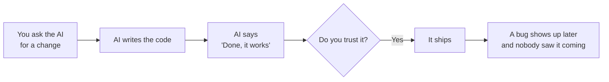
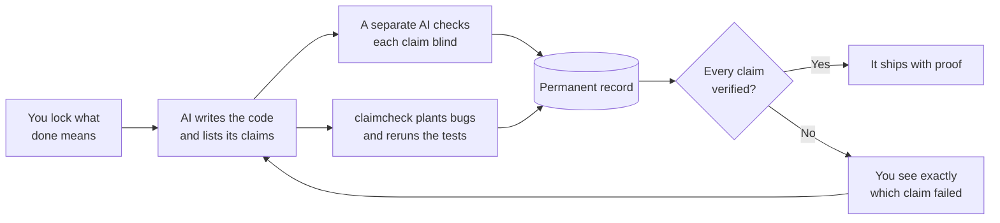

# claimcheck

[](https://github.com/pfinazzo/claimcheck/actions/workflows/ci.yml)

@author Patrick Finazzo ([pfinazzo](https://github.com/pfinazzo)). Developed privately starting Oct 15, 2026; published Oct 24, 2026.

**A second opinion for code written by AI.**

AI coding assistants write code and then say it works. Sometimes they're wrong, and they sound just as sure either way. claimcheck doesn't take their word for it:

1. **Before the work starts, you write down what "done" means, and it's locked** so nobody can quietly move the goalposts later.
2. **Every change the AI makes has to come with a list of what it claims to do,** like "orders over $50 now ship free."
3. **A separate AI checks each claim against the actual change.** It never sees the first AI's explanations or how confident it was, so it can't be talked into agreeing.
4. **claimcheck slips small bugs into the new code on purpose** and reruns your tests. If the tests still pass, they weren't really checking that code.
5. **Every result goes into a permanent record** that shows if anyone edits or deletes an entry later.

At the end you can see which claims were actually verified and which were only confident. This is that view, in the Desk app. Every claim is a ball in a 3D box, and the red sheets are the warning lines.


*Sample data for a made-up checkout service. [How to read this chart](#reading-the-confidence-map) explains every part of it in plain words.*

## The problem it solves

When an AI writes code and then writes the tests for that code, the tests check the cases the AI thought of. The bugs that reach production live in the cases it didn't. So "all tests pass" and "I'm 95% sure" say very little about the part that matters.

Here is the shape of it, with a made-up example. You ask for a "Delete my account" button that leaves none of the user's personal data behind. The AI deletes the user's row, posts and comments, then writes one test that checks the user is gone. The test passes and the AI reports 95% confidence. The app also stores uploaded photos and saved card details. The AI never thought of them, so no test mentions them. Everything is green and the data is still there.

claimcheck pushes on that gap in three ways:

- **The goal is locked first.** "No photos, payment details, posts or comments remain" is written down before any code exists, so the AI can't shrink it to "the user row is gone."
- **The tests get tested.** claimcheck plants small bugs in the new code and reruns the tests. A bug that nobody notices marks a place the tests don't really look.
- **The claim is read against the code by a reader who doesn't know how sure the AI was.** A claim of "all personal data is removed" next to a change that touches three tables is the kind of mismatch a fresh reader can see.

claimcheck can't see what the change doesn't show, and it can't know about data nobody told it about. What it does is stop "the tests pass" and "I'm confident" from standing in for proof. [Limits, stated plainly](#limits-stated-plainly) has the rest.

**Without claimcheck**



**With claimcheck**



## Use it in your own repo

Six steps take a project from nothing to a checked change. Each links to the detail further down.

1. **Install claimcheck.** You need Python 3.11 or newer and a git repository.

   ```bash
   pip install "claimcheck[claude] @ git+https://github.com/pfinazzo/claimcheck"
   ```

   Or from a clone: `git clone https://github.com/pfinazzo/claimcheck.git`, then `pip install -e "./claimcheck[claude]"`. It is not on PyPI. See [Install](#install).

2. **Set up your repo.**

   ```bash
   cd your-repo
   claimcheck init
   ```

   It walks you through everything:

   

   `init` ignores `.env` and key files first, then writes the config, installs the pre-commit hook and adds the claimcheck rules to your `CLAUDE.md` or `AGENTS.md` if you have one. Run in a terminal, it then offers to start your first spec. With `--yes` it does the setup and stops. It uses your Claude Code sign-in, or `ANTHROPIC_API_KEY` when that is set. See [Setup](#setup-claimcheck-init).

3. **Freeze a spec.**

   ```bash
   claimcheck spec draft
   ```

   That is a conversation with Claude that ends in frozen acceptance criteria on a new `task/` branch. To write it yourself, edit `.claimcheck/spec.md`, run `claimcheck spec freeze` and make a branch. See [Writing the spec with Claude](#writing-the-spec-with-claude).

4. **Let your agent work on the task branch.** It reads the rules from `CLAUDE.md` or `AGENTS.md`. Every commit that changes code has to include an updated `.claimcheck/claims.yaml`, and the hook refuses a commit that does not. The hook is optional: it lives in `.git/hooks`, and you can delete the claimcheck line from it. See [Using it day to day](#using-it-day-to-day) and [Writing good claims](#writing-good-claims).

5. **Check it.**

   ```bash
   claimcheck run
   claimcheck verify-ledger
   ```

   `run` checks each claim with the blind checker, plants bugs in the added lines and reruns your tests. `verify-ledger` is optional. It fails if a ledger line was removed or edited. To try the planted-bug half without Claude, use `claimcheck run --provider stub`: every claim then comes back UNVERIFIABLE.

6. **Optional: run it in CI.**

   ```bash
   claimcheck init --ci github
   ```

   Then add `ANTHROPIC_API_KEY` as a repository secret. See the CI paragraph in [Using it on a team](#using-it-on-a-team).

I ran steps 1, 2, 3 (by hand), 4 and 5 in a throwaway repository, installing from GitHub and using the stub provider. The live Claude paths (`spec draft` and a real `run`) and the generated CI workflow were not part of that check.

## A real catch

This one is from claimcheck's own history. The task was a small change to claimcheck itself: make `claimcheck run` stop when the diff is empty. Claude Code wrote the change and a claim about it, then `claimcheck run` checked it.

The claim, stated at 0.93 confidence:

> `claimcheck run` on an empty diff exits with code 7 and prints on stderr that the diff is empty, naming committing the change and `--worktree` as the ways forward.

The independent checker saw the frozen criteria, the diff and the claim text. It never saw the 0.93. It answered REFUTED:

> In default mode, run raises an error with code 7 and the message names both ways forward. But the claim covers any empty diff, and the `--worktree` branch raises a different message. That message says only "Make a change first." and names neither commit nor `--worktree`. The kill-condition test only covers default mode.

That is the ledger line for the run, trimmed:

```json
{
  "claim_id": "c1",
  "confidence": 0.93,
  "kill_condition": "test: tests/test_empty_diff.py::test_run_refuses_an_empty_diff_and_says_what_to_do",
  "checker": {
    "provider": "auto",
    "model": "claude-opus-5-5",
    "verdict": "REFUTED",
    "evidence": ["    if worktree:", "        raise EmptyDiffError(", "            f\"the diff is empty: the working tree has no changes against '{base}'. Make a change first.\""]
  },
  "mutation": { "catch_rate": 1.0, "killed": 1, "survived": 0, "total": 1 },
  "run_id": "20261025T000841Z-96b2"
}
```

The checker was right. The test only exercised the default mode, so a green test run hid the gap. The fix changed the message and added a test for the other mode, and the next run (`20261025T001442Z-2dee`) supported both of the narrowed claims. The change is [pull request 6](https://github.com/pfinazzo/claimcheck/pull/6), and every run above is in this repo's [ledger](.claimcheck/ledger.jsonl).

Two things to read this fairly:

- The planted bugs did not find this. The diff gave them one line to change, an exit code, and the tests caught it. The catch came from the checker reading the diff against the claim.
- A verdict is one reading, not a proof. A later run on the same unfixed code came back SUPPORTED (`20261025T001147Z-6741`). That run is marked invalid in its commit message, because a rejected commit meant it judged older code than I thought. It also shows the checker does not always give the same answer twice.

## Example: the weak-test catch

A real planted-bug run on a small demo project. The change adds free shipping for orders of $50 or more:

```python
def shipping_fee(total):
    """Orders of $50 or more ship free; everything else costs $5."""
    if total >= 50:
        return 0
    return 5
```

The author's tests cover a big order and a small order and nothing near the boundary. They pass, and the author states 0.92 confidence. When `claimcheck run` planted four bugs in `src/shipping.py`:

| Outcome | Planted bug | Real bug? |
| --- | --- | --- |
| survived | `if total >= 50:` became `if total >= 51:` | Yes, $50 would now pay shipping |
| survived | `if total >= 50:` became `if total > 50:` | Yes, $50 would now pay shipping |
| killed | `return 0` became `return 1` | Caught |
| killed | `return 5` became `return 6` | Caught |

The catch rate is 50%. Two real boundary bugs would have shipped with a green test run.


Pinning the boundary with three tests (exactly $50, just under, just over) catches all four:


*This is a demo project, not claimcheck's own code. The planted-bug numbers and the board come from real runs. Both boards use the offline stand-in for the checker, so the "supported" verdict was scripted. The section above is the run where the real checker caught something.*

Each run writes one JSON line per claim. This is the second run, trimmed:

```json
{
  "claim_id": "c1",
  "confidence": 0.95,
  "checker": { "provider": "stub", "verdict": "SUPPORTED", "reason": "The comparison is >= 50 returning 0, else 5.", "evidence": ["+    if total >= 50:"] },
  "mutation": { "catch_rate": 1.0, "killed": 4, "survived": 0, "timeout": 0, "total": 4 },
  "outcome": null
}
```

`outcome` stays `null` until something happens in the real world, such as a later bug fix that touches the same lines. The Desk app writes it when you resolve a claim.

## Contents

- [The problem it solves](#the-problem-it-solves)
- [Use it in your own repo](#use-it-in-your-own-repo)
- [A real catch](#a-real-catch)
- [Example: the weak-test catch](#example-the-weak-test-catch)
- [How it works](#how-it-works)
- [Install](#install)
- [Setup: `claimcheck init`](#setup-claimcheck-init)
- [Writing the spec with Claude](#writing-the-spec-with-claude)
- [What is sent to Claude](#what-is-sent-to-claude)
- [Using it day to day](#using-it-day-to-day)
- [Using it on a team](#using-it-on-a-team)
- [The Desk app](#the-desk-app)
- [Writing good claims](#writing-good-claims)
- [Reference](#reference)
- [Troubleshooting](#troubleshooting)
- [Limits, stated plainly](#limits-stated-plainly)
- [Credit and prior art](#credit-and-prior-art)
- [Development](#development)

## How it works

Every change carries three checks that its author cannot influence.

1. **Criteria frozen before the code exists.** Acceptance criteria are hashed into a lock file. Anything added or edited afterwards is refused.
2. **A second opinion that cannot see the author's confidence.** A separate model reads only the frozen criteria, the diff and the bare claims. It never sees how sure the author was or what evidence the author cited.
3. **Planted bugs.** claimcheck breaks the new code on purpose, one small change at a time, and reruns your tests. The share of planted bugs your tests catch is printed next to the confidence the author stated.

```
 spec.md ──freeze──▶ spec.lock          criteria, hashed, before any code
                         │
 agent writes code ──▶ claims.yaml      claim + confidence + what would prove it wrong
                         │
       claimcheck run ───┼──▶ checker      blind verdict per claim: SUPPORTED / REFUTED / UNVERIFIABLE
                         └──▶ mutate       plant bugs in the added lines, rerun your tests, count catches
                                │
                                ▼
                         ledger.jsonl      one line per claim, append-only
```

## Install

Python 3.11 or newer, and a git repository. claimcheck is not on PyPI, so install it from GitHub:

```bash
pip install "claimcheck[claude] @ git+https://github.com/pfinazzo/claimcheck"
```

Or from a clone, which is also how you work on claimcheck itself:

```bash
git clone https://github.com/pfinazzo/claimcheck.git
pip install -e "./claimcheck[claude]"
```

You do not need an API key. If you have Claude Code installed and signed in, claimcheck uses that sign-in. An `ANTHROPIC_API_KEY` in your environment is used instead when it is set. Drop `[claude]` if you only want the sign-in route or the offline stub.

Claude is not required. The `openai` provider works with any server that speaks OpenAI's chat completions API: OpenAI itself, or a model on your own machine through Ollama, LM Studio or vLLM. See [Using a model other than Claude](#using-a-model-other-than-claude).

## Setup: `claimcheck init`

Run it from the root of the repository you want to protect. It is a short guided tour, one screen at a time. Press Enter to move on, `m` for more detail on a screen, `s` to skip the explanation. Nothing is committed until the last step, and you can stop with Ctrl+C at any point: whatever finished is kept, and running `init` again continues.

### 1. The problem


A confident claim is shown next to the question the rest of the tool answers: do the tests actually back it?

### 2. Three checks


The three checks, with a small animated example of a planted bug: the comparison `>=` becomes `>`, the tests still pass (survived), a boundary test is added, and the same bug is now caught (killed).

### 3. Set up this repo


This is the part that changes your repo. The first step is always the same: **secrets first**. Before anything else is written, `init` creates `.gitignore` if it is missing and makes sure `.env` and key files are ignored. If a secret file is already committed, it tells you, because ignoring a file does not remove it from history.

Then, in order:

| Step | What it does |
| --- | --- |
| Secrets | Creates `.gitignore` if missing. Adds `.env`, `.env.*` (but not `.env.example`), `*.pem`, `*.key`, `*.p12`, `id_rsa*`, `id_ed25519*`. Warns about any such file that is already tracked |
| Config | Writes `.claimcheck/config.toml`. Detects your stack (Node, Python, Go, Rust, Maven, Gradle) and fills in the test command and the list of paths that are not product code. You can type a different test command when asked |
| Commit hook | Installs a pre-commit hook where git actually looks for it. That is the right place even with `core.hooksPath` (husky and similar) or in a linked worktree. An existing hook is kept, and the claimcheck line goes in before a trailing `exit` |
| `.gitignore` | Ignores claimcheck's scratch output (`runs/`, the mutation lock and backup, the app state, the draft) |
| Agent instructions | Adds the claimcheck rules to `CLAUDE.md`, `.claude/CLAUDE.md` and `AGENTS.md`, whichever exist. If none exist you are asked whether to create `CLAUDE.md`. The block sits between two marker comments, so running `init` again updates it in place and never duplicates it |
| CI workflow | Asked once, default no. A GitHub Actions workflow that runs claimcheck on every pull request |

You never copy a block into an instructions file or edit `.gitignore` by hand. The block `init` adds is in [`src/claimcheck/agentdocs.py`](src/claimcheck/agentdocs.py); it tells the agent to check the spec, keep `claims.yaml` current with honest confidence, and run `claimcheck run` before it finishes.

### 4. Connect Claude


claimcheck picks a connection on its own: your API key if `ANTHROPIC_API_KEY` is set, otherwise your Claude Code sign-in. The screen says which one, and says what Claude will see (see [What is sent to Claude](#what-is-sent-to-claude)). If neither is available you are told how to fix it, and setup finishes anyway. You can write the spec by hand in `.claimcheck/spec.md`.

### 5. Your first spec


You say what you want built in a sentence or two, and the conversation starts (details in the next section). When you accept the criteria, claimcheck freezes them and commits them on a new task branch, then shows what to do next. You can press Enter at the goal prompt to skip this and do it later with `claimcheck spec draft`.

### The same setup in the Desk app

If you would rather click than type, open the [Desk app](#the-desk-app) and choose a folder that is a git repository but not set up yet. It starts the same guided setup, one step at a time. Every screen has a "More detail" disclosure, the intro can be skipped, and progress is saved, so closing the app and coming back resumes where you were. The terminal and the app run the same code underneath, so the result is identical and you can use either one.

**1. Welcome.** Three short screens. The first says why a confident claim is not a checked claim, the second lists the three checks, and the third shows a planted bug being missed and then caught. The animation is calm and stops at its last frame if your system asks for reduced motion.


**2. Set up this repository.** One button runs the setup. The checklist that follows is the same as the terminal's: secrets first, then the config, the commit hook, `.gitignore`, and the agent instructions. A secret file that is already committed is called out. The test command is detected and editable, and there is a checkbox for the CI workflow.


**3. Connect Claude.** Check your Claude Code sign-in, use an API key instead, or skip and write the spec by hand.


**4. Write the spec.** Say what you want built. Claude asks questions, each with the reason it matters, and the criteria take shape beside them. Every criterion is editable, with warnings for vague wording, and "Send answers" starts the next round.


**5. Freeze the spec.** The spec is shown as it will be written. "Freeze and commit" locks it and commits it on a new task branch, and shows the lock hash and the commit. Nothing is pushed.


**6. Done.** What to do next: have your coding agent build it on the branch, then press Run claimcheck on the board.


*These screens use sample data for a small checkout service, rendered by the app's own `npm run screenshot` command.*

### Running without the tour

| Command | What you get |
| --- | --- |
| `claimcheck init` | The guided tour, when run in a terminal |
| `claimcheck init --no-tour` | Straight to setup, still guided |
| `claimcheck init --no-animation` | The guided flow without animation. Also automatic when `NO_COLOR` or `CI` is set, or the terminal is `dumb` |
| `claimcheck init --yes` | No prompts, no animation: does the setup and prints a summary. This is what scripts and CI get automatically when there is no terminal |
| `claimcheck init --json` | No prompts. Prints what was done as one JSON document, for tools |
| `claimcheck init --goal "…"` | Starts the spec conversation with that goal |
| `claimcheck init --ci github` | Also writes the CI workflow |
| `claimcheck init --agent-doc claude` | Creates `CLAUDE.md` (or `agents` for `AGENTS.md`) when neither exists |

`init` is safe to run twice. It never overwrites a file that exists. `claimcheck status` tells you where a repo is: whether it is set up, whether a spec is frozen, whether the hook is in place.

## Writing the spec with Claude

`claimcheck spec draft` turns a goal into acceptance criteria through a back-and-forth. It is the same conversation the setup tour ends with, and you can run it any time you start a new task.

```bash
claimcheck spec draft
```

Each round, Claude:

- asks up to five questions, each with a short reason it matters ("it decides which side of the boundary criterion 1 lands on"),
- shows the criteria as they stand, each with a one-line way to check it,
- flags contradictions and assumptions it had to make.

You answer in plain text. A blank answer means "you decide", and Claude says what it assumed. You can also edit the draft yourself at any point, and Claude keeps your wording:

| Type | Does |
| --- | --- |
| Enter | Keep going: Claude folds in your answers and asks what is left. When nothing is left, Enter saves |
| `e 2` | Rewrite criterion 2 |
| `c 2` | Rewrite how criterion 2 is checked |
| `d 2` | Delete criterion 2 |
| `a` | Add a criterion |
| `o` | Add an out-of-scope line |
| `save` | Write the spec and stop |
| `quit` | Leave without writing. Your answers are kept: `claimcheck spec draft --resume` continues |
| `?` | Show this list |

Local warnings appear under a criterion when it uses vague words ("fast", "properly"), names no observable behavior, runs to two ideas, or duplicates another. They are advice, not rules.

At the end claimcheck writes `.claimcheck/spec.md`, freezes it, switches to a new branch named from your goal (for example `task/add-free-shipping-over-50`, only when you were on the base branch) and commits the spec, the lock and the files `init` changed. Nothing is pushed.

| Option | Meaning |
| --- | --- |
| `--goal "…"` | Skip the goal prompt |
| `--resume` | Continue the saved conversation |
| `--max-rounds N` | Stop asking after N rounds (default 6) |
| `--no-freeze` | Write `spec.md` only |
| `--no-branch` / `--branch NAME` | Commit on the current branch, or on a branch with this name |
| `--yes` | Freeze and commit without asking |
| `--provider auto\|claude\|claude-cli\|openai\|stub` | Which model connection. `stub` is offline and gives placeholder questions. `openai` takes its model from `OPENAI_MODEL` |

The result is a plain file you can read and edit before it is frozen:

```markdown
# Acceptance criteria

Goal: Orders of $50 or more should ship free, and everything else pays a $5 flat fee.

- [ ] 1. An order whose subtotal is exactly $50.00 pays $0 shipping.
  - Check: shipping fee for a $50.00 subtotal is 0
- [ ] 2. An order whose subtotal is under $50.00 pays $5 shipping.
  - Check: shipping fee for a $49.99 subtotal is 5

## Out of scope

- International shipping rates
```

If you would rather write it by hand, edit `.claimcheck/spec.md` (lines in the form `- [ ] 1. text`, numbered from 1) and run `claimcheck spec freeze`.

Freezing a second task in the same repo works the way you would expect: only changed code blocks a new freeze, so editing the spec on a fresh branch is fine.

## What is sent to Claude

Anything that leaves your machine is filtered first. The filter runs where each prompt is built and again at the connection itself, so a mistake in one place does not get through the other.

| Layer | What it does |
| --- | --- |
| Secret files | Files that look like secret stores are never read into a prompt, and their names are not listed. That covers `.env` and `.env.*`, private keys and certificates (`*.pem`, `*.key`, `*.p12`, `*.jks`), `id_rsa` and friends, `.npmrc`, `.pypirc`, `.netrc`, credentials and secrets files and folders, service-account JSON, Terraform state and variables, kubeconfig, and anything under `.ssh`, `.aws`, `.kube` or `.docker` |
| Secret values | In every other file, text that looks like a secret is replaced with `[REDACTED:kind]` before it is sent: API keys for Anthropic, OpenAI, AWS, GitHub, GitLab, Slack, Stripe, Google, npm, Twilio and SendGrid, JWTs, bearer tokens, private key blocks, passwords in URLs, assignments to names like `password`, `token` or `api_key`, and long random strings. Ordinary code such as `password = get_password()` is left alone |
| Size cap | At most 40,000 characters per file and 250,000 per request |

What each feature sends:

| Feature | Sent | Not sent |
| --- | --- | --- |
| Spec conversation | Your goal, your answers, your edits to the criteria, the repo's file names | Secret-looking file names, file contents |
| Claim check | The frozen criteria, the claims (text and files), the diff under test | The author's confidence and evidence, anything in `.claimcheck/`, secret files, secret values |
| Planted bugs | Nothing. This runs your tests locally | Everything |

Two more protections follow from this:

- You can see what was held back. The result of `claimcheck check` has a `sent` section listing the withheld files, how many values were redacted and of what kind, and whether anything was cut for size. It never contains the secret itself.
- When Claude runs through your Claude Code sign-in, claimcheck starts it with its file, shell and web tools switched off and from a temporary folder, so it works only from the text it was handed.

This is a safety net, not a guarantee. The patterns lean toward redacting too much, but a secret in an unusual format can slip past, and a key that was ever committed should be rotated whatever claimcheck does. `init` closes the usual hole first (`.env` ignored, committed secrets reported), and the Desk app applies the same filter and a deny list for Claude Code's file tools (see [The Desk app](#the-desk-app)). The Python and Desk filters are tested against the same set of cases, in [`tests/fixtures/secret_cases.json`](tests/fixtures/secret_cases.json), so they cannot drift apart.

## Using it day to day

After setup, a task looks like this.

1. **Spec.** `claimcheck spec draft` (or edit `spec.md` and run `claimcheck spec freeze`). The spec and lock are committed first, alone, on a task branch.
2. **Build.** Your coding agent works on the branch. It reads the claimcheck rules from `CLAUDE.md` or `AGENTS.md`. Each commit that changes code includes an updated `.claimcheck/claims.yaml`, and the commit hook refuses one that does not.
3. **Check.** `claimcheck run` verifies the lock, asks the blind checker about each claim, plants bugs and reruns your tests, then appends one ledger line per claim. It prints one JSON document and saves it under `.claimcheck/runs/`.
4. **Decide.** Look at the board (below), fix what is weak, accept a risk with a reason, or narrow a claim.
5. **Merge.** Commit `ledger.jsonl` with the merge so the history travels with the code.

## Using it on a team

| Role | Does | Owns |
| --- | --- | --- |
| **Requester** (human) | Runs `claimcheck spec draft` with the agent's task in mind and freezes it before work starts | `spec.md`, `spec.lock` |
| **Author** (agent or human) | Writes the code and the claims, with honest confidence | `claims.yaml`, the diff |
| **CI** | Runs `claimcheck run` on every pull request | The ledger line |
| **Reviewer** (human) | Reads the board, not the whole diff. Starts with the decision queue | The merge decision |

The author never grades their own work: someone else fixes the criteria, a model that cannot see the author's confidence gives the verdict, and your own tests produce the catch rate.

**What to commit and ignore.** Commit `spec.md`, `spec.lock`, `claims.yaml`, `config.toml` and `ledger.jsonl`. `init` already ignores the scratch output. The lock must be in git: the late-criteria check compares the lock's freeze time with the branch's first commit.

**CI.** `claimcheck init --ci github` writes `.github/workflows/claimcheck.yml`, which checks out full history, installs claimcheck and runs it against the pull request's base branch with `ANTHROPIC_API_KEY` from your repository secrets. It has not been run in a real pipeline yet, so treat it as a starting point. The run edits files in the checkout while it plants bugs and then restores them, which is fine in a throwaway CI checkout.

**Turning it into a gate.** By default `mutate` only reports. To fail a build on weak tests, set a floor in `.claimcheck/config.toml`:

```toml
[mutate]
min_catch_rate = 0.7     # exit code 2 if fewer than 70% of planted bugs are caught
```

A sensible rollout: report only for the first couple of weeks, then set a floor a little under your median, then raise it as your tests improve. A REFUTED verdict already fails a run with exit code 2.

**Keep tests out of the mutation pool.** `init` puts your test folders on the `ignore` list for you, so planted bugs go into product code only. If you write the config by hand, add your test paths to `ignore`.

## The Desk app

Desk is an Electron app that reads a repo's `.claimcheck/ledger.jsonl` and shows it as a plain board: the claims that need a person on one side, the claims that are backed below them, and the selected claim's evidence beside them. It also runs the [guided setup](#the-same-setup-in-the-desk-app) for a repo that is not set up yet. It lives in [`app/`](app/); see [`app/README.md`](app/README.md).

```bash
cd app
npm install
npm start
```

Node 24 or newer. Use **Open repo** to pick a project.


A slim top bar shows the repo, the branch and whether the spec is frozen, with **Write a spec**, **Connect Claude**, **Run claimcheck** and **Open repo**. One sentence summarises the repo. Each claim is a row with one muted line: what the author stated, what the checker said, and how many planted bugs the tests caught. Select a row to see why it is flagged, what the checker said, and each planted bug that survived.

From a flagged claim, **Fix this** proposes three or four different ways to resolve it. You pick one, Desk builds it on a branch in a separate worktree, runs your tests, and records the outcome in the ledger. A fix only counts as resolved when the tests pass **and** a change was actually committed. **Accept the risk** takes a one-line reason and writes it to the ledger. Arrow keys move through the list, and the page follows your system's light or dark setting.

Desk has a **Light**, **Dark** and **Auto** switch at the right end of the top bar. Every screenshot in this README is the dark look. The confidence map below also has a light one.

Pressing **Fix this** shows the approaches Claude proposes, with the one it recommends first and the reason. **Inspect the code** shows exactly what Claude committed, read only.


When no claim needs a decision, a banner says so and offers **Open pull request**. It says plainly that backed is a good sign, not a sign-off.


Before anything runs, Desk lists the commands the repo would run and waits for you. **Connect GitHub** checks that `gh` is signed in. **Open repo** takes any git repository on the computer.


### Pull requests and issues

Desk reads the open pull requests and issues of the repo's GitHub remote through the GitHub CLI, so it works on any repo with a remote, whether or not that repo uses claimcheck yet. Each pull request shows its checks, review state, whether it can merge, the issues it closes, its files and its description, drawn as Markdown. Nothing is written to GitHub unless you press a button that says so.


When a pull request's branch carries claims, **Check this pull request** fetches it into a folder of its own, so your checkout is never touched, and grades the claims there. It lists the commands first and runs nothing until you agree. It uses the base branch's claimcheck settings when it has them, so a pull request cannot loosen its own checks. **Post results** shows the exact comment first, and posts it only when you press Post comment. An issue offers **Write a spec from this issue**.


### Reading the confidence map

Desk has a second tab next to the list, called **Confidence map**. It shows every claim at once, the ones that passed and the ones that did not. Each claim is one ball inside a see-through box. Where the ball sits tells you how far to trust that claim.


*The same sample data in light mode.*

#### What the three directions mean

The box asks three questions about every claim. A ball's position is the answer to all three at once.

| Direction | The question | What the number is | The good end |
| --- | --- | --- | --- |
| **Up** | How sure was the AI that wrote the code? | The confidence it stated, from 0 to 1. | The top |
| **Right** | Would your tests catch a mistake? | claimcheck plants small bugs in the new code and reruns your tests. This is the share of those bugs that your tests noticed, from 0 (none) to 1.0 (all). | The right |
| **Toward you** | Did a second AI agree? | The verdict of the separate checker that read the claim and the code: refuted, unverifiable or supported. | The side nearest you at the start, which is supported |

The best place for a ball is high, far to the right and near you. That is a claim the AI was sure about, the tests back up, and the second AI agreed with.

The labels along the edges of the box tell you which way is which, even after you turn it.

#### What the colors and shapes mean

- A **red ball** needs a decision from you.
- A **blue ball** is backed. Nothing about it is flagged.
- A **grey ball** is settled. You fixed it, or you accepted the risk.
- A **ring** around a ball means the second AI said the claim is false.
- A thin **line down to the floor** has no meaning of its own. It only helps you see where the ball is.

#### The red sheets and the green box

Three red sheets cut through the box. Each one is a warning line, and a ball on the wrong side of a sheet gets flagged.

| Red sheet | A claim is flagged when it is | In plain words |
| --- | --- | --- |
| **Confidence below 0.75** | Below the sheet | The AI was not sure about its own claim, or gave no number at all. |
| **Tests below 0.8** | To the left of the sheet | Your tests missed more than 2 of every 10 planted bugs, or no planted-bug run covers the claim yet. |
| **Checker not satisfied** | On the far side of the sheet | The second AI did not say "supported". It said refuted or unverifiable, or nobody has run the check yet. |

The small **green box** is the good corner: sure enough, well tested and confirmed. A ball outside the green box has at least one warning. A red ball still needs a decision. A grey ball had a warning that you have already dealt with.

The first two lines are settings. The defaults are below, and you can change them in `.claimcheck/config.toml`. Desk reads these and the command line ignores them. The checker sheet has no setting.

```toml
[app]
flagConfidence = 0.75
flagCatchRate = 0.8
```

#### How to read it in ten seconds

1. Find the green box. Balls inside it are fine.
2. Look at the red balls. Each one needs a decision.
3. Look hardest at red balls that are **high and on the left**. The AI was very sure, and the tests are weak. In the picture, claim c6 says 0.97, and the tests caught only half of the planted bugs. This is the kind of claim claimcheck exists to find.
4. A red ball that is **low** is a claim the AI doubted itself. It is telling you where it is unsure.
5. A **ring** means the second AI disagrees with the claim. Open the claim to read why.

#### The strips at the edge: when nothing was measured

Some claims have nothing to measure in one direction. They sit in a thin strip just outside the box on that side.

- **no run** (the tests side): no planted-bug run covers this claim yet.
- **none** (the confidence side): the author gave no confidence.
- **not checked** (the checker side): the second AI has not looked at this claim yet.

A ball in a strip does not mean zero. It means nobody has measured that yet. Press **Run claimcheck** to fill it in.

#### Moving around and getting details

- **Drag** to turn the box, **scroll** to zoom, **right-drag** to slide it, and **double-click** to go back to the start. The box turns slowly by itself until you touch it.
- **Hover** over a ball to read its claim.
- **Click** a ball to select it. The card on the right shows its numbers, and **Open claim** takes you to the full page for that claim.
- The table under the chart lists every claim with the exact numbers in words, riskiest first.
- Balls with the same numbers are moved apart a little so that none hides another. The table has the true numbers.
- If your computer cannot draw 3D graphics, Desk shows the table on its own and says so.

Desk reads Claude Code's sign-in or an API key stored encrypted by your operating system. Before anything goes to Claude it applies the same secret filter as the command line. In Claude Code mode it denies the file tools access to credential files and blocks `cat`, `grep`, `curl`, `git push` and package installs. The first run in a repository shows the exact commands its config and claims name and asks before running them. The page is built without `innerHTML`, so text from a repository can never become markup.

## Writing good claims

A claim is one sentence about the diff that could turn out false. Your agent writes these, following the rules `init` added to its instructions, but it helps to know what makes a good one.

- One checkable statement per claim. "`shipping_fee` returns 0 at exactly $50" is a claim. "The shipping feature works" is not.
- Cite the criteria it supports by number, and list every file it is about.
- State real confidence. If the code was not run, 0.6 is better than 0.95.
- A `kill_condition` that names something outside the claim: `test:` (a test id), `cmd:` (a command whose failure disproves it) or `obs:` (an observable value). One that only repeats the claim is rejected.

```yaml
version: 1
author: "claude-code"
base: "main"
claims:
  - id: c1
    claim: "shipping_fee returns 0 for orders of $50 or more and 5 for anything under"
    confidence: 0.92
    criteria: [1, 2, 3]
    files: ["src/shipping.py"]
    kill_condition: "test: tests/test_shipping.py::test_exactly_fifty_ships_free"
    verified_by:
      - "cmd: python -m pytest -q"
```

The validator rejects an `id` that is not lowercase letters, digits, `-` or `_`, empty text, a confidence outside 0 to 1, a bad `kill_condition`, an empty `verified_by` or `files`, fields of the wrong type, and criteria numbers that are not in the frozen lock (exit code 4). The commit hook requires, for every commit that changes code: an updated `claims.yaml` in the same commit, every file a claim lists to be in that commit, and every changed code file to be covered by some claim. Deletions count as changes.

## Reference

### Commands

```
claimcheck init                    guided setup: secrets, config, hook, .gitignore, agent notes, first spec
claimcheck status [--json]         where this repo is: set up, spec state, hook, branch
claimcheck spec draft              write the spec as a conversation with Claude
claimcheck spec freeze             hash the criteria into spec.lock
claimcheck spec verify             refuse if the spec drifted from the lock
claimcheck claims validate [path]  schema-check a claims file against the frozen criteria
claimcheck check                   independent verdict per claim
claimcheck mutate                  planted-bug catch rate on the changed lines
claimcheck run                     verify, validate, check, mutate, then append to the ledger
claimcheck verify-ledger [--base REF]  fail if a ledger line was removed, edited, moved or inserted
claimcheck hook pre-commit         what the installed git hook runs
```

Options shared by `check`, `mutate` and `run`:

| Option | Meaning |
| --- | --- |
| `--base REF` | The git ref the diff is measured against. Defaults to `base` in config |
| `--worktree` | Measure uncommitted changes, including new untracked files, instead of `base...HEAD` |
| `--provider auto\|claude\|claude-cli\|openai\|stub` | Which model connection (`check` and `run`) |
| `--model NAME` | Checker model (`check` and `run`) |
| `--test-cmd CMD` | Override the test command (`mutate` and `run`) |
| `--max-mutants N` | Cap the number of planted bugs (`mutate` and `run`) |
| `--seed N` | Make the sample of planted bugs repeatable |
| `--restore` | After a crashed `mutate`, put backed-up files back (see Troubleshooting) |

`check`, `mutate` and `run` print one JSON document to stdout and save it under `.claimcheck/runs/`. Messages for people go to stderr. The machine modes `init --json`, `status --json`, `spec draft --step` and `spec draft --finish` also print JSON, and on failure print `{"error": "...", "code": N}` and exit with that code.

### Providers

| Name | Uses |
| --- | --- |
| `auto` (default) | `ANTHROPIC_API_KEY` if set, otherwise your Claude Code sign-in |
| `claude` | The Anthropic API through the official SDK. Needs `claimcheck[claude]` and `ANTHROPIC_API_KEY` |
| `claude-cli` | Your Claude Code sign-in through the `claude` command, with all tools off. No API key |
| `openai` | Any OpenAI-compatible server: OpenAI, or a local one such as Ollama. Never picked by `auto`. See below |
| `stub` | Offline and deterministic. Every claim comes back UNVERIFIABLE, and the spec conversation gives placeholder questions. Good for trying the planted-bug half |

#### Using a model other than Claude

The `openai` provider sends each request to an OpenAI-compatible chat completions endpoint. It needs no extra package. Three environment variables set it up:

| Variable | Meaning |
| --- | --- |
| `OPENAI_BASE_URL` | Where the server is, up to and including `/v1`. Defaults to `https://api.openai.com/v1` |
| `OPENAI_API_KEY` | The key the server wants, sent as a bearer token. Leave it unset for a local server that needs none |
| `OPENAI_MODEL` | The model to ask when no other model is given. `spec draft` always uses it |

For `check` and `run`, the model is `--model` if you pass it, otherwise `model` under `[checker]` in `.claimcheck/config.toml`. So switch both lines together:

```toml
[checker]
provider = "openai"
model = "qwen2.5:7b"
```

A model on your own machine with [Ollama](https://ollama.com):

```bash
ollama pull qwen2.5:7b
export OPENAI_BASE_URL=http://localhost:11434/v1
export OPENAI_MODEL=qwen2.5:7b
claimcheck spec draft --provider openai
claimcheck run --provider openai --model qwen2.5:7b
```

OpenAI itself: set `OPENAI_API_KEY`, leave `OPENAI_BASE_URL` unset, and name a model your account can use.

How it asks:

- The request carries the reply's JSON schema as `response_format`, and the user message repeats the schema as text. Some servers ignore `response_format`, so the text is the backup.
- A reply wrapped in a Markdown code block is unwrapped.
- Each call is one request with a 300 second limit. The checker already asks once more when a reply is unusable.
- The same secret filter as the Claude providers runs on every request. See [What is sent to Claude](#what-is-sent-to-claude): it applies to this server too.

If something is wrong, the error says what to check: the server is not running, the key was refused (401 or 403), the address or model name is wrong (404), or the account is rate limited (429).

A small local model is a weaker checker than Claude. It may mark claims UNVERIFIABLE more often, or miss a contradiction. The planted-bug half does not use a model, so it is as strong as ever.

The Desk app still connects to Claude only. Use the command line for another provider.

### Exit codes

| Code | Meaning |
| --- | --- |
| 0 | ok |
| 1 | other error, including an invalid config value |
| 2 | a claim was REFUTED, or the catch rate is under `min_catch_rate` |
| 3 | spec refusal: drifted from the lock, re-frozen after code changed, or a base ref that does not exist |
| 4 | claims file invalid, or the pre-commit hook rejected the commit |
| 5 | provider error, unknown provider, the baseline tests fail, or the working tree no longer matches the diff |
| 6 | a previous `mutate` left its lock behind, or `--restore` refused to overwrite a file |
| 7 | the diff is empty, so there is nothing to verify (commit the change, or pass `--worktree`) |
| 8 | `verify-ledger` found a ledger line that was removed, edited, moved or inserted |

### Files

| File | Purpose |
| --- | --- |
| `.claimcheck/spec.md` | Acceptance criteria as `- [ ] 1. text` lines |
| `.claimcheck/spec.lock` | JSON with a hash per criterion and the freeze time. The spec is hashed with line endings and any BOM normalised, so Windows and Linux agree |
| `.claimcheck/claims.yaml` | One entry per claim. See [`examples/claims.yaml`](examples/claims.yaml) |
| `.claimcheck/ledger.jsonl` | Append-only and hash-chained: each new line carries `prev`, the SHA-256 of the line before it, and `claimcheck verify-ledger` checks the chain. Lines written before chaining existed are sealed by the first chained line. See [`examples/ledger.jsonl`](examples/ledger.jsonl) |
| `.claimcheck/config.toml` | Settings. See [`examples/config.toml`](examples/config.toml) |
| `.claimcheck/setup.json` | The files `init` changed outside `.claimcheck/`, so the first commit includes them |

### Config

`init` writes this, with your detected test command and ignore list. A value of the wrong type is reported with the key's name instead of being silently ignored.

```toml
version = 1
base = "main"                       # the ref diffs are measured against
test_cmd = "npm test"               # rerun once per planted bug
ignore = ["*.md", "docs/**", ".claimcheck/**", "*.lock", ".gitignore", ".github/**", "tests/**"]
require_full_coverage = true        # the hook rejects uncovered code files (false = warn)

[checker]
provider = "auto"                   # "auto" | "claude" | "claude-cli" | "openai" | "stub"
model = "claude-opus-5-5"

[mutate]
max_mutants = 50
timeout_s = 600                     # per test run; the whole process tree is killed on timeout
min_catch_rate = 0.0                # 0.0 reports only; raise it to gate
```

`ignore` uses glob matching where `*` and `**` both cross folders, and a leading `**/` also matches the top level.

### The four kinds of planted bug

Mutations are text-level and language-agnostic. They apply only to lines the diff adds, and never inside string literals.

| Kind | Example |
| --- | --- |
| Sign flip | `a + b` becomes `a - b`, and a unary minus is dropped |
| Off by one | `50` becomes `51` |
| Swapped arguments | `f(a, b)` becomes `f(b, a)` |
| Boundary shift | `>=` becomes `>`, and `<` becomes `<=` |

A mutant that does not compile counts as killed, because the test command fails.

## Troubleshooting

**`mutate.lock exists: a previous mutate run did not finish`**
`mutate` edits your files while it plants bugs, and it restores them even if it fails or you press Ctrl+C. The lock only stays behind if a restore itself failed. Run `claimcheck mutate --restore`. It puts back a file only when the file still holds the planted bug, and leaves any file you edited since. For those it prints which file and why, keeps the backup in `.claimcheck/mutate-backup/`, and exits 6. Sort it out by hand, then delete `.claimcheck/mutate.lock`.

**`... line 6 no longer matches the diff`**
You edited a file after committing it. `mutate` checks every planted bug against the current file before it touches anything, so nothing was changed. Commit or stash your edits and rerun.

**The commit is rejected with "staged paths with no claim covering them"**
A changed file is not listed in any claim's `files`. Add it to a claim, add it to `ignore` if it is not product code, or set `require_full_coverage = false` to warn instead.

**The commit is rejected with "files not in the staged diff"**
A claim lists a file that is not in this commit. Claims describe one commit's diff.

**`spec drifted from lock` (exit 3)**
`spec.md` no longer matches `spec.lock`. If you did not mean to change it, `git checkout .claimcheck/spec.md`. If the criterion really was wrong, start a new task on a new branch and freeze again.

**`refusing to re-freeze with an open diff`**
Code has already changed on this branch. Freezing a new spec is allowed until then, so start the next task on a fresh branch from the base.

**`base ref 'main' was not found`**
The branch named in `config.toml` does not exist here, often in a shallow CI clone. Fetch it (`git fetch origin main`), correct `base`, or pass `--base origin/main`.

**The baseline tests fail (exit 5)**
claimcheck runs your tests once before planting anything. If they fail on the unmodified code there is nothing to measure.

**Part of my diff was withheld from the checker**
That is the secret filter. The `sent` section of the check result names the files and counts the redactions. A file such as `.env` should not be committed at all: `claimcheck init` reports any that are.

**A planted bug survived but is not really a bug**
Some text changes do not change behavior. In a `clamp` function, `if x < lo` and `if x <= lo` return the same value at the boundary, so no test can tell them apart. Read the survivors, judge each, and accept the risk with a reason for the harmless ones.

**The hook does nothing**
Run `claimcheck status`. `init` installs the hook where git reads it, including with `core.hooksPath` and in worktrees. If you recreate your virtual environment, run `claimcheck init` again so the hook points at the new Python.

**Animations look wrong**
Use `--no-animation`, or set `NO_COLOR=1`. On older Windows consoles, Windows Terminal renders the box drawing and colors correctly.

## Limits, stated plainly

- **The checker only sees the diff.** Anything under `.claimcheck/` is removed from it, so it never sees your confidence, your evidence or earlier ledger lines. It cannot run your code. A claim that depends on runtime behavior comes back `UNVERIFIABLE`, which is honest but not a pass.
- **The catch rate measures your tests, not your code.** A high rate means your tests would notice small breakages in the lines you added. It does not mean the code is right.
- **Four kinds of planted bug.** Real bugs are more varied, so the rate is a floor for how responsive your tests are, not a full audit.
- **Equivalent mutants exist.** Some planted bugs do not change behavior and always survive. Judge survivors, do not just count them.
- **Only added lines are mutated.** Bugs in untouched code that the change relies on are out of scope. Files that are not valid UTF-8 are skipped and counted.
- **The secret filter is a safety net.** See [What is sent to Claude](#what-is-sent-to-claude).
- **The ledger is tamper-evident, not tamper-proof.** The hash chain catches a line that was removed from the middle, edited, moved or inserted. It cannot see the last line being cut off, so CI also runs `verify-ledger --base` to require that the ledger on the base branch is an unchanged beginning of yours. Someone with write access to the whole file can still rewrite every line and recompute the chain, and nothing here signs it. The protection is that the rewrite shows up in the git history.
- **Confidence is not calibrated yet.** Version 1 makes sure the data exists. The calibration curve comes once the ledger has real outcomes in it.
- **The spec is only as good as the person who wrote it.** claimcheck proves the code matches the frozen spec and that the spec was not bent afterward. It cannot tell you the spec was the right one.
- **The animated setup is verified by tests and rendered frames, not by every terminal.** If something looks wrong in yours, `--no-animation` gives the plain flow.

## Development

```bash
python -m venv .venv
.venv/Scripts/activate          # on macOS and Linux: source .venv/bin/activate
pip install -e ".[dev,claude]"
ruff check                      # lint: the coding conventions a linter can check
mypy                            # type check of src/ and tests/
pytest                          # about 380 tests, around 100 seconds

cd app
npm install
npm run lint                    # ESLint with the same conventions
npm test                        # type checks, lints, builds, then about 90 tests
npm run build                   # bundles the main process, the preload and the page into dist/
```

Desk is written entirely in TypeScript (strict, no `any`) and a test fails if any hand-written JavaScript appears.

The repo rules for coding agents live in `CLAUDE.md`, which Claude Code reads. `AGENTS.md` is a word-for-word copy for agents that read that file instead, such as OpenAI's Codex. Edit both, or a test fails.

```
src/claimcheck/   the CLI: init flow, onboarding, spec conversation, checker, mutate, ledger, hook, redaction, providers
tests/            Python tests; fixtures/secret_cases.json is shared with the Desk tests
app/              the Desk Electron app
examples/         a sample spec, claims file, config and ledger
docs/screenshots/ images used in this README
```

The terminal screens in this README are real frames from the onboarding run rendered to images. The Desk images come from the app's own `npm run screenshot` command, using a small demo project. The confidence map images use sample claims for a made-up checkout service, drawn with `npm run screenshot -- <repo> out.png --view board:graph`.

## Credit and prior art

claimcheck was designed and built by Patrick Finazzo. The design is the combination: criteria frozen before the code is written and checked by a lock, claims that carry a stated confidence and a kill condition, a checker that never sees the confidence, planted bugs to measure whether the tests would notice, and an append-only ledger that lets you compare confidence against outcomes over time.

The parts have a history, and it is worth saying so. Mutation testing is decades old and has tools such as Stryker, PIT and mutmut. Hashing a spec and flagging drift, and running an independent check against agent claims, both appear in other tools, for example FleetProof and FalseGreen. I found no tool that puts these pieces together around AI-written diffs with calibration tracked in a ledger, but I only searched in October 2026 and may have missed one.

If you use claimcheck or build on its design, please cite it using [CITATION.cff](CITATION.cff), which GitHub shows as "Cite this repository".

## License

MIT. See [LICENSE](LICENSE). The license requires the copyright notice, "Copyright (c) 2026 Patrick Finazzo", to stay in every copy and substantial portion of the code.
