# claimcheck

[](https://github.com/pfinazzo/claimcheck/actions/workflows/ci.yml)

@author Patrick Finazzo ([pfinazzo](https://github.com/pfinazzo)). Developed privately starting Oct 15, 2026; published Oct 24, 2026.

**A second opinion for code written by AI.**

AI coding assistants write code and then say it works. Sometimes they are wrong. They sound just as sure when they are wrong as when they are right. claimcheck does not take their word for it. It works in five steps:

1. **You write down what "done" means before the work starts.** claimcheck then locks that list. Nobody can quietly change the goal later.
2. **The AI lists what its change does.** Every change must come with these statements, called claims. An example claim: "orders over $50 now ship free."
3. **A second AI checks each claim against the code that changed.** It never sees the first AI's explanations or how confident the first AI was. So the first AI cannot talk it into agreeing.
4. **claimcheck puts small bugs into the new code on purpose, then reruns your tests.** If the tests still pass with a bug in place, they were not really checking that code.
5. **Every result goes into a permanent record.** The record shows if anyone later edits or deletes an entry.

At the end, you can see which claims were actually checked and which were only stated with confidence. The picture below shows that view in Desk, claimcheck's desktop app. Every claim is a ball in a 3D box. The red sheets are warning lines.

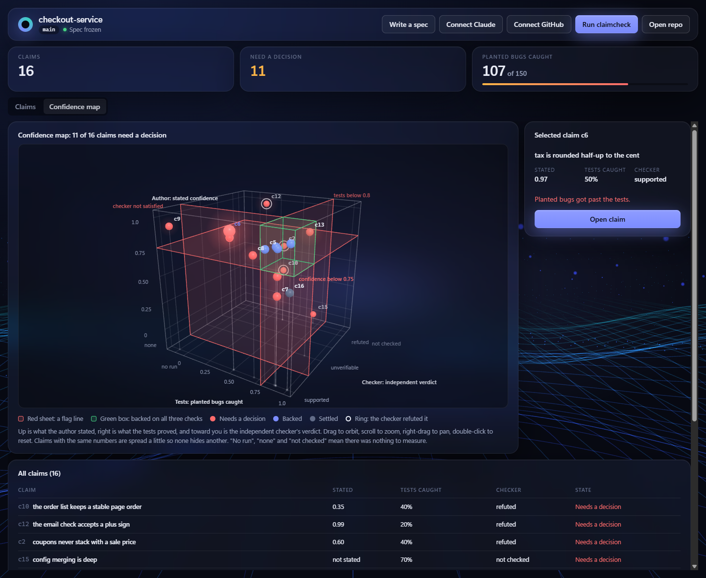

*Sample data for a made-up checkout service. [How to read this chart](#reading-the-confidence-map) explains every part of it in plain words.*

## The problem it solves

An AI often writes code and then writes the tests for that code. Those tests check the cases the AI thought of. The bugs that reach real users live in the cases it did not think of. So "all tests pass" and "I'm 95% sure" say very little about the part that matters.

Here is a made-up example of how that goes wrong:

- You ask for a "Delete my account" button. It must leave none of the user's personal data behind.
- The AI deletes the user's row, their posts and their comments.
- The AI writes one test. The test checks that the user is gone.
- The test passes. The AI reports 95% confidence.
- The app also stores uploaded photos and saved card details. The AI never thought of them, so no test mentions them.
- Every test is green, and the photos and card details are still there.

claimcheck pushes on that gap in three ways:

- **The goal is locked first.** "No photos, payment details, posts or comments remain" is written down before any code exists. The AI cannot later shrink the goal to "the user row is gone."
- **The tests get tested.** claimcheck puts small bugs into the new code and reruns the tests. If no test notices a bug, that part of the code is not really being checked.
- **A second reader checks the claim against the code, without knowing how sure the AI was.** Take a claim that says "all personal data is removed", next to a change that touches only three tables. A fresh reader can see that mismatch.

claimcheck has limits. It cannot see anything the change does not show. It cannot know about data nobody told it about. What it does is stop "the tests pass" and "I'm confident" from standing in for proof. [Limits, stated plainly](#limits-stated-plainly) lists the rest.

**Without claimcheck**

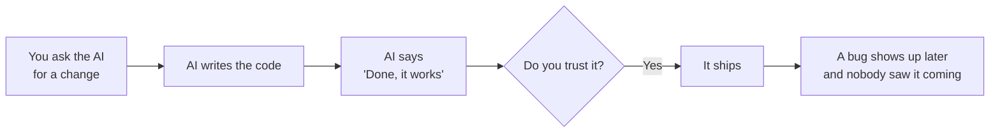

**With claimcheck**

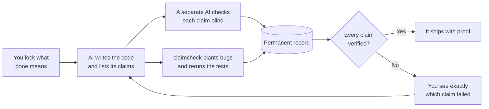

## Words this README uses

These words have a specific meaning here. Each one is explained again where it first matters.

| Word | What it means |
| --- | --- |
| **Spec** | The list of what "done" means for one task, written before any code. Each item on the list is an **acceptance criterion**. |
| **Freeze** | Lock the spec. claimcheck saves a fingerprint of each criterion in a file called `spec.lock`. After that, claimcheck refuses a spec that was edited or added to. |
| **Claim** | One sentence the AI writes about its change, such as "`shipping_fee` returns 0 at exactly $50". It comes with a confidence from 0 to 1, saying how sure the AI is. |
| **Diff** | The lines a change adds and removes, compared with the branch the work started from. That starting branch is the **base**, usually `main`. |
| **Checker** | A second AI that reads the frozen spec, the diff and the claims. It never sees how confident the AI was, or the AI's reasons. It gives each claim one **verdict**. |
| **Supported** | A verdict. The checker read the diff and found that the code does what the claim says. |
| **Refuted** | A verdict. The checker read the diff and found that the code does not do what the claim says. Its reason, and the lines it relied on, go into the ledger. The run fails. |
| **Unverifiable** | A verdict. The checker could not tell from the diff alone. Often the claim is about what the code does when it runs, and the checker cannot run code. By default, the run fails until someone deals with the claim, as described next. |
| **Needs a person** | What an unverifiable claim becomes. There are two ways to clear it. Anyone, the coding AI included, can rewrite the claim so it says only what the diff shows. Or a person can check the claim another way and record that with `claimcheck accept`. The coding AI is told never to run `accept` itself. |
| **Planted bug** | A small mistake claimcheck puts into a new line of code on purpose, such as turning `>=` into `>`. claimcheck then reruns your tests. |
| **Caught** or **missed** | If your test command fails with the planted bug in place, the tests caught it. That includes a planted bug that stops the code from building. If the tests still pass, they missed it. In the record, a caught bug is "killed" and a missed one "survived". A test run that takes too long is recorded as a "timeout". |
| **Catch rate** | The share of planted bugs your tests caught, from 0 (none) to 1 (all). |
| **Kill condition** | The check that would show a claim is false. Most name one test in the repo, like `test: tests/test_shipping.py::test_exactly_fifty_ships_free`. If that test fails, the claim is wrong. Every claim must give one. claimcheck never runs that test. The checker reads the code and judges whether the test would fail. |
| **Provider** | How claimcheck reaches an AI model: your Claude Code sign-in, an Anthropic API key, any server that works like OpenAI's, or `stub`, an offline stand-in that answers unverifiable to every claim. |
| **Run** | One `claimcheck run`. It checks the spec lock, asks the checker about every claim, plants bugs and records the results. |
| **Ledger** | The permanent record, in `.claimcheck/ledger.jsonl`. In the tasks layout, each task has its own, in the task's folder. Lines are only ever added. Each run adds one line per claim, and `claimcheck accept` and the Desk app add lines too. Each new line contains a fingerprint of the line before it, so a line edited, moved, inserted or removed from the middle shows up. [Limits, stated plainly](#limits-stated-plainly) says what it cannot catch. |
| **Board** | The main screen of Desk, claimcheck's desktop app. It shows the claims that need a decision, then the claims that are backed. |
| **Backed** | Desk's word for a claim that no warning flags: supported by the checker, well tested, and stated with enough confidence. |

## What it caught in its first five days

<picture>
  <source media="(prefers-color-scheme: dark)" srcset="docs/screenshots/caught-bugs-dark.png">
  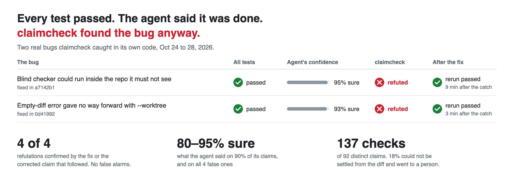
</picture>

From Oct 24 to 28, 2026, AI agents wrote claimcheck's own code. claimcheck checked their changes as they went. Every number below comes from this repo's [ledger](.claimcheck/ledger.jsonl), so you can check each one yourself.

- **137 checks of 92 different claims.** A check is one claim, checked once by one run. After a fix, the next run checks the same claims again. That is why there are more checks than claims.
- **4 claims were refuted.** For each of these, the checker read the change and found that the code did not do what the claim said.
- **3 of the 4 refuted claims came from 2 real bugs in the code.** Every test passed while each bug was in place. The ledger shows this: claimcheck plants bugs only after your whole test suite passes, and both of these runs planted bugs.
- **Both bugs were fixed, and the fixes passed a later run.** In that run, the checker found that the claims now held. That happened 9 minutes after one bug was caught and 6 minutes after the other.
- **The fourth refuted claim said more than the code did.** The claim said unknown HTML tags were removed from the text. In fact they stayed in the text as plain characters. That is safe, so the code stayed as it was and the claim was rewritten to match it.
- **None of the 4 was a false alarm.** In every case, the fix or the rewritten claim that followed showed the checker had been right.
- **The AI's confidence told you nothing.** The AI said it was 80% to 95% sure on 90% of its claims. It said the same on all 4 claims that turned out false.
- **18% of checks needed a person.** On those, the checker's verdict was unverifiable: the change alone did not show whether the claim was true. Often the claim was about what the code does when it runs. claimcheck now fails a run like that until the claim is rewritten to match what the change shows, or a person checks it another way and records that with `claimcheck accept`.

[A real catch](#a-real-catch) walks through the empty-diff bug, with its ledger line.

## Use it in your own repo

Six steps take a project from nothing to a checked change. Each step links to more detail further down.

1. **Install claimcheck.** You need Python 3.11 or newer, and a git repository.

   ```bash
   pip install "claimcheck[claude] @ git+https://github.com/pfinazzo/claimcheck"
   ```

   claimcheck is not on PyPI. You can also install it from a copy of the code: run `git clone https://github.com/pfinazzo/claimcheck.git`, then `pip install -e "./claimcheck[claude]"`. See [Install](#install).

2. **Set up your repo.**

   ```bash
   cd your-repo
   claimcheck init
   ```

   It walks you through everything:

   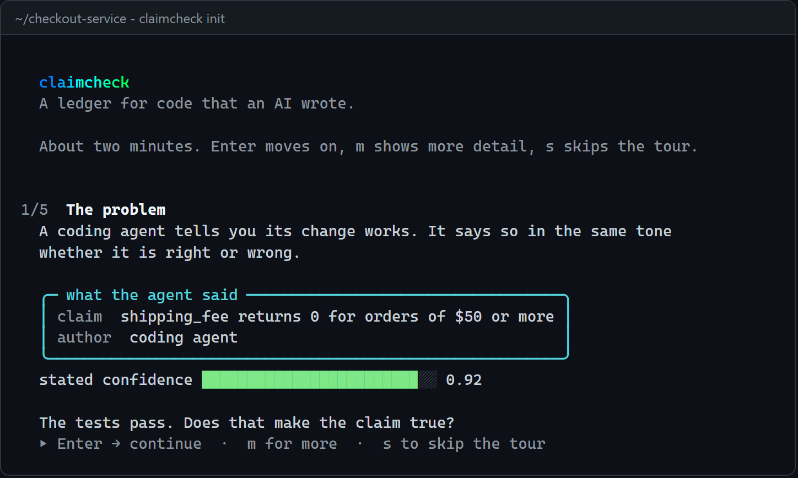

   `init` does these things in order:

   - It tells git to ignore `.env` and key files, so secrets do not get committed.
   - It writes claimcheck's settings file.
   - It installs a pre-commit hook. That is a small script git runs before each commit.
   - It adds claimcheck's rules for your coding AI to `CLAUDE.md` or `AGENTS.md`, if you have one.
   - In a terminal, it then offers to start your first spec.

   With `--yes`, it does the setup and stops. To talk to Claude, it uses your Claude Code sign-in. If `ANTHROPIC_API_KEY` is set, it uses that key instead. See [Setup](#setup-claimcheck-init).

3. **Write and freeze a spec.**

   ```bash
   claimcheck spec draft
   ```

   This starts a conversation with Claude about what you want built. It ends with frozen acceptance criteria, committed on a new `task/` branch. You can also write the spec yourself: edit `.claimcheck/spec.md`, run `claimcheck spec freeze`, and make a branch. See [Writing the spec with Claude](#writing-the-spec-with-claude).

4. **Let your coding AI work on the task branch.** It reads claimcheck's rules from `CLAUDE.md` or `AGENTS.md`. Every commit that changes code must also update the claims file, `.claimcheck/claims.yaml`. The hook refuses a commit that does not. The hook is optional. It lives in `.git/hooks`, and you can delete the claimcheck line from it. See [Using it day to day](#using-it-day-to-day) and [Writing good claims](#writing-good-claims).

5. **Check the work.**

   ```bash
   claimcheck run
   claimcheck verify-ledger
   ```

   `run` asks the checker about each claim. It also plants bugs in the lines the change added and reruns your tests. `verify-ledger` is optional. It fails if any line in the ledger was removed or edited.

   You can try the planted-bug half without Claude: use `claimcheck run --provider stub`. The stub is an offline stand-in for the checker. It answers unverifiable for every claim, so the run ends with exit code 9, which means "needs a person". See [When the checker can't tell](#when-the-checker-cant-tell).

6. **Optional: run it in CI.** CI is the automated build that runs on every pull request.

   ```bash
   claimcheck init --ci github
   ```

   Then add `ANTHROPIC_API_KEY` as a repository secret on GitHub. See the CI paragraph in [Using it on a team](#using-it-on-a-team).

I tested steps 1 to 5 in a throwaway repository, installed from GitHub, using the stub. I wrote the spec in step 3 by hand. That test did not cover the parts that use the real Claude, which are `spec draft` and a real `run`. It did not cover the generated CI workflow either.

## A real catch

This example comes from claimcheck's own history. The task was a small change to claimcheck itself: make `claimcheck run` stop when the diff is empty. Claude Code wrote the change and a claim about it. Then `claimcheck run` checked the claim.

This was the claim. Claude Code stated it with 0.93 confidence, meaning 93% sure:

> `claimcheck run` on an empty diff exits with code 7 and prints on stderr that the diff is empty, naming committing the change and `--worktree` as the ways forward.

The checker saw the frozen criteria, the diff and the claim text. It never saw the 0.93. Its verdict was REFUTED, with this reason:

> In default mode, run raises an error with code 7 and the message names both ways forward. But the claim covers any empty diff, and the `--worktree` branch raises a different message. That message says only "Make a change first." and names neither commit nor `--worktree`. The kill-condition test only covers default mode.

In plain words: the claim said every empty-diff error explained both ways forward. With the `--worktree` option, the error did not. The only test checked the other mode.

This is the ledger line for that run, shortened:

```json
{
  "claim_id": "c1",
  "confidence": 0.93,
  "kill_condition": "test: tests/test_empty_diff.py::test_run_refuses_an_empty_diff_and_says_what_to_do",
  "checker": {
    "provider": "auto",
    "model": "claude-opus-5-5",
    "verdict": "REFUTED",
    "evidence": ["    if worktree:", "        raise EmptyDiffError(", "            f\"the diff is empty: the working tree has no changes against '{base}'. Make a change first.\""]
  },
  "mutation": { "catch_rate": 1.0, "killed": 1, "survived": 0, "total": 1 },
  "run_id": "20261025T000841Z-96b2"
}
```

The checker was right. The test only tried the default mode, so a passing test run hid the gap. The fix changed the message and added a test for the `--worktree` mode. The claims were narrowed to match. The next run, `20261025T001442Z-2dee`, found both narrowed claims supported. The change is [pull request 6](https://github.com/pfinazzo/claimcheck/pull/6). Every run mentioned here is in this repo's [ledger](.claimcheck/ledger.jsonl).

Two things to keep in mind when reading this example:

- **The planted bugs did not find this one.** The diff gave them only one line to change, an exit code, and the tests caught that bug. The catch came from the checker reading the diff against the claim.
- **A verdict is one reading, not a proof.** A later run on the same unfixed code came back SUPPORTED. That was run `20261025T001147Z-6741`. Its commit message marks it as invalid: a commit had been rejected, so the run judged older code than I thought. It also shows that the checker does not always give the same answer twice.

## Example: the weak-test catch

This is a real planted-bug run on a small demo project. The change adds free shipping for orders of $50 or more:

```python
def shipping_fee(total):
    """Orders of $50 or more ship free; everything else costs $5."""
    if total >= 50:
        return 0
    return 5
```

The author's tests check a big order and a small order. Nothing tests an order near $50. The tests pass, and the author states 0.92 confidence. Then `claimcheck run` planted four bugs in `src/shipping.py`, one at a time:

| Outcome | Planted bug | Real bug? |
| --- | --- | --- |
| survived | `if total >= 50:` became `if total >= 51:` | Yes, $50 would now pay shipping |
| survived | `if total >= 50:` became `if total > 50:` | Yes, $50 would now pay shipping |
| killed | `return 0` became `return 1` | Caught |
| killed | `return 5` became `return 6` | Caught |

"Survived" means every test still passed with the bug in place. "Killed" means a test failed, so the bug was caught. The catch rate is 50%. Two real bugs at the $50 boundary would have shipped with every test passing.

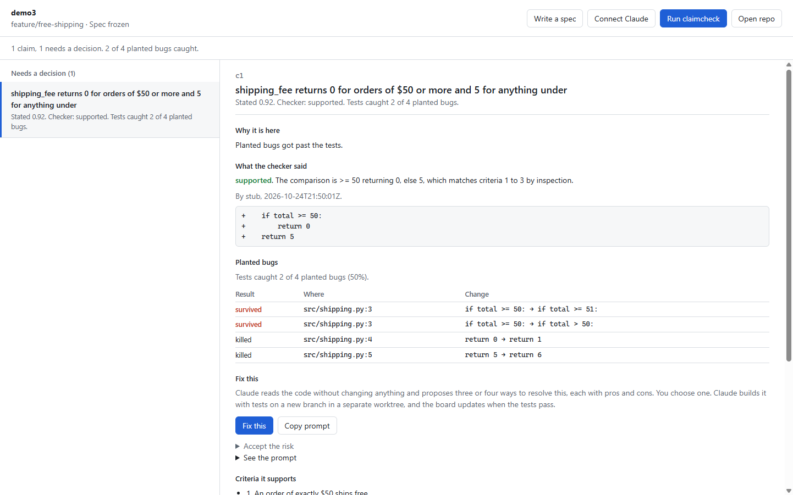

Three new tests pin the boundary: exactly $50, just under and just over. With them, the tests catch all four bugs:

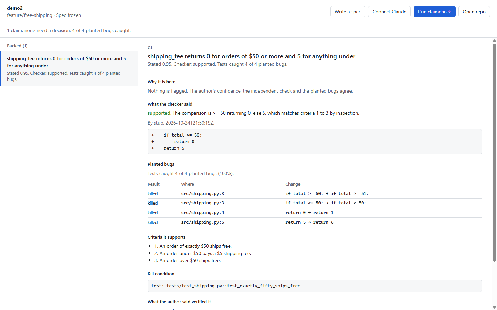

*This is a demo project, not claimcheck's own code. The planted-bug numbers and the board come from real runs. Both boards used the offline stand-in for the checker, so their "supported" verdict was scripted. The section above, [A real catch](#a-real-catch), is the run where the real checker caught something.*

Each run writes one JSON line per claim. This is the line from the second run, shortened:

```json
{
  "claim_id": "c1",
  "confidence": 0.95,
  "checker": { "provider": "stub", "verdict": "SUPPORTED", "reason": "The comparison is >= 50 returning 0, else 5.", "evidence": ["+    if total >= 50:"] },
  "mutation": { "catch_rate": 1.0, "killed": 4, "survived": 0, "timeout": 0, "total": 4 },
  "outcome": null
}
```

`outcome` stays `null` until something happens in the real world, such as a later bug fix that touches the same lines. The Desk app fills it in when you resolve a claim.

## Contents

- [The problem it solves](#the-problem-it-solves)
- [Words this README uses](#words-this-readme-uses)
- [What it caught in its first five days](#what-it-caught-in-its-first-five-days)
- [Use it in your own repo](#use-it-in-your-own-repo)
- [A real catch](#a-real-catch)
- [Example: the weak-test catch](#example-the-weak-test-catch)
- [How it works](#how-it-works)
- [Install](#install)
- [Setup: `claimcheck init`](#setup-claimcheck-init)
- [Writing the spec with Claude](#writing-the-spec-with-claude)
- [What is sent to Claude](#what-is-sent-to-claude)
- [Using it day to day](#using-it-day-to-day)
- [Using it on a team](#using-it-on-a-team)
- [The Desk app](#the-desk-app)
- [Writing good claims](#writing-good-claims)
- [Reference](#reference)
- [Troubleshooting](#troubleshooting)
- [Limits, stated plainly](#limits-stated-plainly)
- [Credit and prior art](#credit-and-prior-art)
- [Development](#development)

## How it works

Every change goes through three checks. The author of the change cannot influence any of them. The author is usually your coding AI.

1. **Criteria frozen before the code exists.** claimcheck saves a fingerprint, called a hash, of each acceptance criterion in a lock file. If anyone adds or edits a criterion afterwards, claimcheck refuses it.
2. **A second opinion that cannot see the author's confidence.** A separate AI model, the checker, reads only three things: the frozen criteria, the diff and the bare claims. It never sees how sure the author was. It never sees the evidence the author cited.
3. **Planted bugs.** claimcheck breaks the new code on purpose, one small change at a time, and reruns your tests after each one. It prints the share of planted bugs your tests caught next to the confidence the author stated.

```
 spec.md ──freeze──▶ spec.lock          criteria, hashed, before any code
                         │
 agent writes code ──▶ claims.yaml      claim + confidence + what would prove it wrong
                         │
       claimcheck run ───┼──▶ checker      blind verdict per claim: SUPPORTED / REFUTED / UNVERIFIABLE
                         └──▶ mutate       plant bugs in the added lines, rerun your tests, count catches
                                │
                                ▼
                         ledger.jsonl      one line per claim, append-only
```

## Install

You need Python 3.11 or newer, and a git repository. claimcheck is not on PyPI, so install it from GitHub:

```bash
pip install "claimcheck[claude] @ git+https://github.com/pfinazzo/claimcheck"
```

You can also install it from a copy of the code. That is also how you work on claimcheck itself:

```bash
git clone https://github.com/pfinazzo/claimcheck.git
pip install -e "./claimcheck[claude]"
```

You do not need an API key:

- If Claude Code is installed and signed in, claimcheck uses that sign-in.
- If `ANTHROPIC_API_KEY` is set in your environment, claimcheck uses that key instead.
- You can drop `[claude]` from the install if you only want the Claude Code sign-in or the offline stub.

You do not need Claude either. The `openai` provider works with any server that speaks OpenAI's chat completions API. That includes OpenAI itself, or a model on your own computer through Ollama, LM Studio or vLLM. See [Using a model other than Claude](#using-a-model-other-than-claude).

## Setup: `claimcheck init`

Run `claimcheck init` from the top folder of the repository you want to protect. It is a short guided tour, one screen at a time:

- Press Enter to move on.
- Press `m` for more detail on a screen.
- Press `s` to skip the explanation.

Nothing is committed until the last step. You can stop with Ctrl+C at any point. Whatever finished is kept, and running `init` again carries on from there.

### 1. The problem


This screen shows a confident claim. Next to it is the question the rest of the tool answers: do the tests actually back it up?

### 2. Three checks

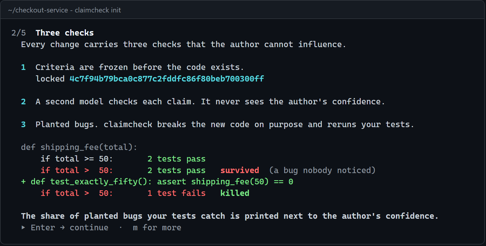

This screen shows the three checks, with a small animated example of a planted bug:

1. The comparison `>=` becomes `>`.
2. The tests still pass, so the bug survived.
3. A test for the boundary is added.
4. The same bug is now caught, so it was killed.

### 3. Set up this repo

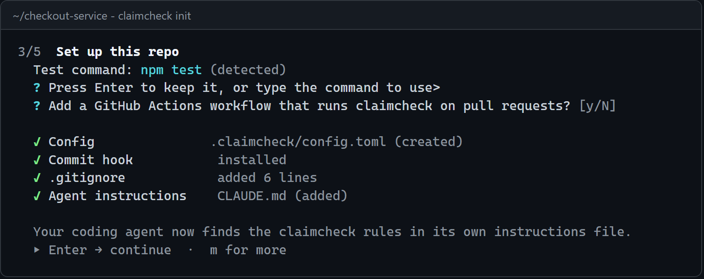

This is the part that changes your repo. The first step is always the same: **secrets first**. Before anything else is written, `init` creates `.gitignore` if it is missing. It makes sure git ignores `.env` and key files. If a secret file is already committed, `init` tells you. Ignoring a file does not remove it from git's history.

Then `init` does these steps, in order:

| Step | What it does |
| --- | --- |
| Secrets | Creates `.gitignore` if missing. Adds `.env`, `.env.*` (but not `.env.example`), `*.pem`, `*.key`, `*.p12`, `id_rsa*` and `id_ed25519*`. Warns about any of these files that git already tracks |
| Config | Writes the settings file, `.claimcheck/config.toml`. Detects your stack: Node, Python, Go, Rust, Maven or Gradle. Fills in your test command and the list of paths that are not product code. You can type a different test command when asked |
| Commit hook | Installs a pre-commit hook in the place git actually looks for it. That place is correct even with `core.hooksPath`, which tools like husky use. It is also correct in a linked worktree, which is a second working folder of the same repo. If you already have a hook, it is kept, and the claimcheck line goes in before any final `exit` |
| `.gitignore` | Tells git to ignore claimcheck's scratch output: `runs/`, the mutation lock and backup, the app state and the draft |
| Agent instructions | Adds claimcheck's rules to `CLAUDE.md`, `.claude/CLAUDE.md` and `AGENTS.md`, whichever of them exist. If none exist, it asks whether to create `CLAUDE.md`. The rules sit between two marker comments. So running `init` again updates them in place and never adds a second copy |
| CI workflow | Asks once, with the default answer no. If you say yes, it adds a GitHub Actions workflow that runs claimcheck on every pull request |

You never copy rules into an instructions file or edit `.gitignore` by hand. The rules `init` adds are in [`src/claimcheck/agentdocs.py`](src/claimcheck/agentdocs.py). They tell your coding AI to do three things: check the spec, keep `claims.yaml` up to date with honest confidence, and run `claimcheck run` before it finishes.

### 4. Connect Claude

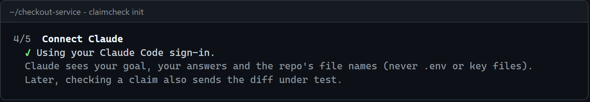

claimcheck picks how to reach Claude on its own:

- If `ANTHROPIC_API_KEY` is set, it uses your API key.
- Otherwise, it uses your Claude Code sign-in.

The screen says which one it picked. It also says what Claude will see. See [What is sent to Claude](#what-is-sent-to-claude). If neither is available, the screen tells you how to fix that, and setup finishes anyway. You can then write the spec by hand in `.claimcheck/spec.md`.

### 5. Your first spec

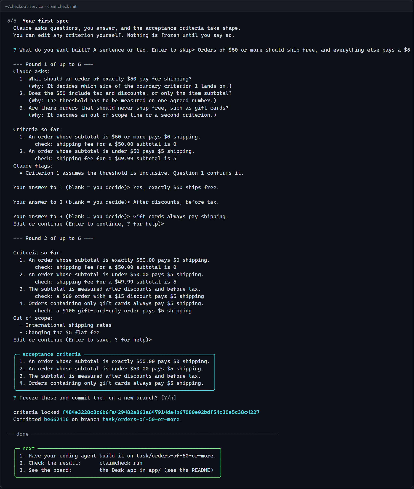

You say what you want built, in a sentence or two. Then the conversation with Claude starts. The next section has the details. When you accept the criteria, claimcheck freezes them and commits them on a new task branch. Then it shows what to do next. To skip this step, press Enter at the goal prompt. You can do it later with `claimcheck spec draft`.

### The same setup in the Desk app

You can click through setup instead of typing. Open the [Desk app](#the-desk-app) and choose a folder that is a git repository but not set up yet. Desk starts the same guided setup, one step at a time:

- Every screen has a "More detail" section you can open.
- You can skip the introduction.
- Your progress is saved. If you close the app and come back, you resume where you were.

The terminal and the app run the same code underneath. The result is identical, so you can use either one.

**1. Welcome.** Three short screens:

- The first says why a confident claim is not a checked claim.
- The second lists the three checks.
- The third shows a planted bug being missed and then caught.

The animation is calm. If your system asks for reduced motion, it stops at its last frame.

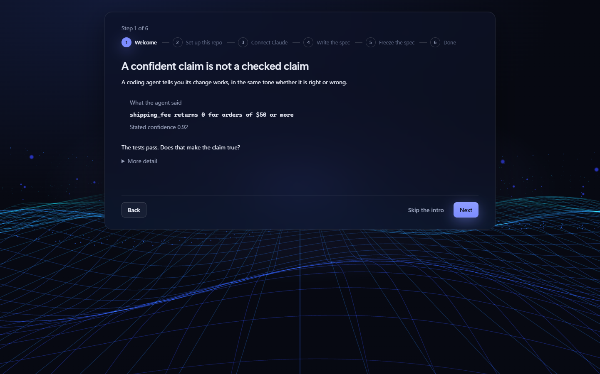

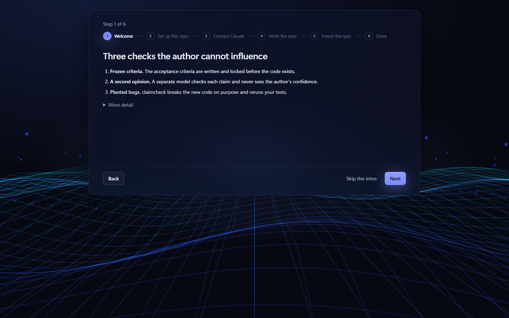

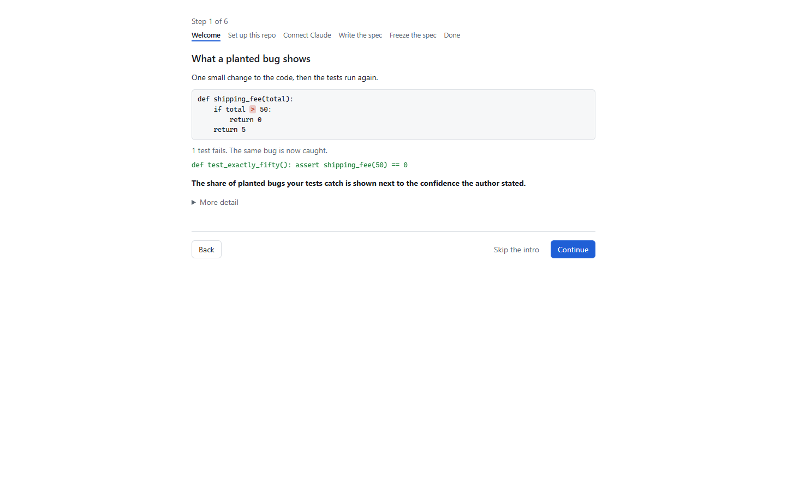

**2. Set up this repository.** One button runs the setup. The checklist that follows is the same as the terminal's: secrets first, then the settings file, the commit hook, `.gitignore` and the agent instructions. If a secret file is already committed, Desk points it out. Desk detects your test command, and you can edit it. A checkbox adds the CI workflow.

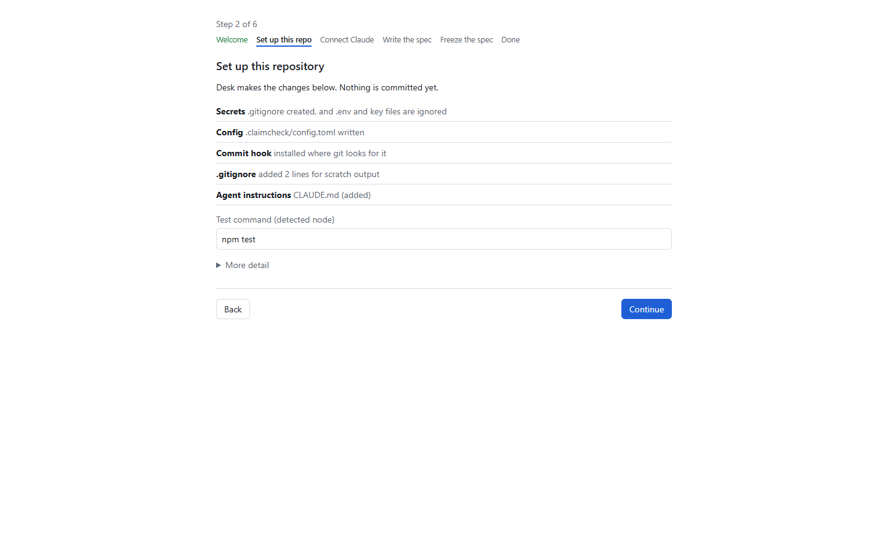

**3. Connect Claude.** You have three choices: check your Claude Code sign-in, use an API key instead, or skip and write the spec by hand.

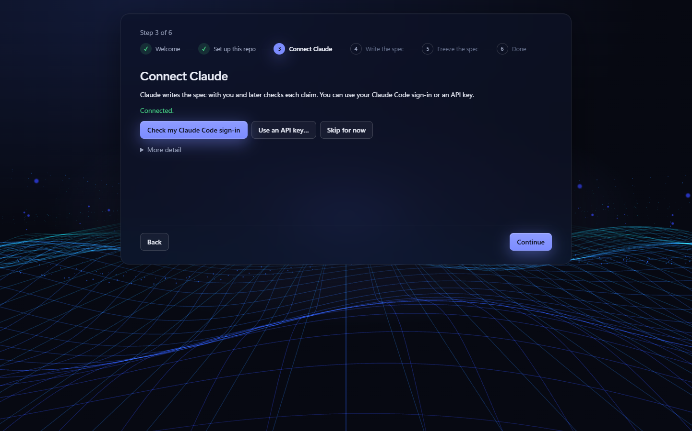

**4. Write the spec.** Say what you want built. Claude asks questions, each with the reason it matters. The criteria take shape beside the questions. You can edit every criterion. Vague wording gets a warning. "Send answers" starts the next round of questions.

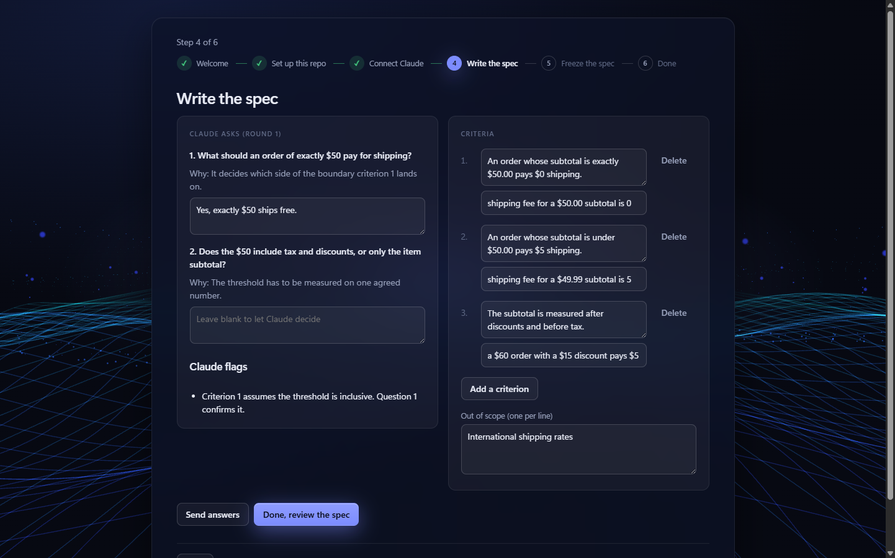

**5. Freeze the spec.** The spec is shown exactly as it will be written. "Freeze and commit" locks it and commits it on a new task branch. Desk then shows the lock's hash and the commit. Nothing is pushed.

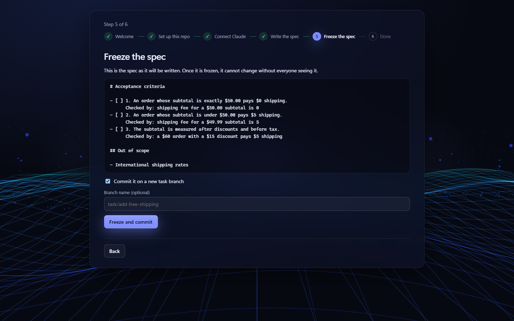

**6. Done.** Desk tells you what to do next: have your coding AI build the task on the branch, then press Run claimcheck on the board.

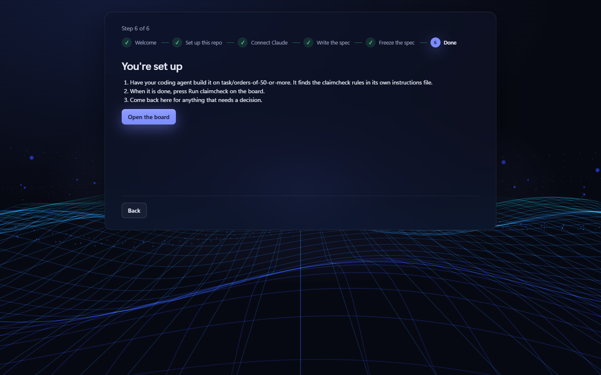

*These screens use sample data for a small checkout service. The app's own `npm run screenshot` command drew them.*

### Running without the tour

| Command | What you get |
| --- | --- |
| `claimcheck init` | The guided tour, when run in a terminal |
| `claimcheck init --no-tour` | Straight to setup, still guided |
| `claimcheck init --no-animation` | The guided flow without animation. This also happens automatically when `NO_COLOR` or `CI` is set, or when the terminal is `dumb` |
| `claimcheck init --yes` | No questions and no animation. It does the setup and prints a summary. Scripts and CI get this automatically when there is no terminal |
| `claimcheck init --json` | No questions. It prints what it did as one JSON document, for other tools to read |
| `claimcheck init --goal "…"` | Starts the spec conversation with that goal |
| `claimcheck init --ci github` | Also writes the CI workflow |
| `claimcheck init --agent-doc claude` | Creates `CLAUDE.md` when neither instructions file exists. Use `agents` instead of `claude` for `AGENTS.md` |

`init` is safe to run twice. It never overwrites a file that already exists. `claimcheck status` tells you where a repo stands: whether it is set up, whether a spec is frozen, and whether the hook is in place.

## Writing the spec with Claude

`claimcheck spec draft` turns your goal into acceptance criteria through a back-and-forth with Claude. It is the same conversation the setup tour ends with. You can run it any time you start a new task.

```bash
claimcheck spec draft
```

In each round, Claude does three things:

- It asks up to five questions. Each comes with a short reason it matters, such as "it decides which side of the boundary criterion 1 lands on".
- It shows the criteria as they stand, each with a one-line way to check it.
- It points out contradictions, and assumptions it had to make.

You answer in plain text. A blank answer means "you decide", and Claude says what it assumed. You can also edit the draft yourself at any point, and Claude keeps your wording. These are the commands you can type:

| Type | Does |
| --- | --- |
| Enter | Keep going. Claude folds in your answers and asks about what is left. When nothing is left, Enter saves |
| `e 2` | Rewrite criterion 2 |
| `c 2` | Rewrite how criterion 2 is checked |
| `d 2` | Delete criterion 2 |
| `a` | Add a criterion |
| `o` | Add a line saying what is out of scope |
| `save` | Write the spec and stop |
| `quit` | Leave without writing. Your answers are kept, and `claimcheck spec draft --resume` continues |
| `?` | Show this list |

claimcheck warns you about a criterion in four cases: it uses vague words like "fast" or "properly", it names nothing you could observe, it contains two ideas, or it repeats another criterion. These warnings are advice, not rules.

At the end, claimcheck does three things:

1. It writes `.claimcheck/spec.md` and freezes it.
2. If you were on the base branch, it switches to a new branch named after your goal, for example `task/add-free-shipping-over-50`.
3. It commits the spec, the lock and the files `init` changed.

Nothing is pushed.

| Option | Meaning |
| --- | --- |
| `--goal "…"` | Skip the goal prompt |
| `--resume` | Continue the saved conversation |
| `--max-rounds N` | Stop asking after N rounds. The default is 6 |
| `--no-freeze` | Write `spec.md` only |
| `--no-branch` / `--branch NAME` | Commit on the current branch, or on a branch with this name |
| `--yes` | Freeze and commit without asking |
| `--provider auto\|claude\|claude-cli\|openai\|stub` | How to reach the AI model. `stub` is offline and gives placeholder questions. `openai` takes its model from `OPENAI_MODEL` |

The result is a plain file. You can read and edit it before it is frozen:

```markdown
# Acceptance criteria

Goal: Orders of $50 or more should ship free, and everything else pays a $5 flat fee.

- [ ] 1. An order whose subtotal is exactly $50.00 pays $0 shipping.
  - Check: shipping fee for a $50.00 subtotal is 0
- [ ] 2. An order whose subtotal is under $50.00 pays $5 shipping.
  - Check: shipping fee for a $49.99 subtotal is 5

## Out of scope

- International shipping rates
```

To write the spec by hand, edit `.claimcheck/spec.md` and run `claimcheck spec freeze`. Write each criterion as a line in the form `- [ ] 1. text`, numbered from 1.

You can freeze a second task's spec in the same repo. Only code that already changed on the branch stops a new freeze. So editing the spec on a fresh branch is fine.

## What is sent to Claude

claimcheck filters everything before it leaves your computer. The filter runs twice: once where each prompt is built, and again at the connection itself. So a mistake in one place cannot get past the other.

| Layer | What it does |
| --- | --- |
| Secret files | Files that look like they store secrets are never put into a prompt. Their names are not listed either. That covers `.env` and `.env.*`; private keys and certificates (`*.pem`, `*.key`, `*.p12`, `*.jks`); `id_rsa` and similar key files; `.npmrc`, `.pypirc` and `.netrc`; files and folders named for credentials or secrets; service-account JSON; Terraform state and variables; kubeconfig; and anything under `.ssh`, `.aws`, `.kube` or `.docker` |
| Secret values | In every other file, text that looks like a secret is replaced with `[REDACTED:kind]` before it is sent. That covers API keys for Anthropic, OpenAI, AWS, GitHub, GitLab, Slack, Stripe, Google, npm, Twilio and SendGrid; JWTs; bearer tokens; private key blocks; passwords inside URLs; values given to names like `password`, `token` or `api_key`; and long random strings. Ordinary code such as `password = get_password()` is left alone |
| Size cap | At most 40,000 characters per file, and 250,000 per request |

What each feature sends:

| Feature | Sent | Not sent |
| --- | --- | --- |
| Spec conversation | Your goal, your answers, your edits to the criteria, and the names of the files in your repo | File names that look like secrets, and the contents of any file |
| Claim check | The frozen criteria, the claims (their text and files), and the diff being checked | The author's confidence and evidence, anything in `.claimcheck/`, secret files and secret values |
| Planted bugs | Nothing. This runs your tests on your own computer | Everything |

Two more protections follow from this:

- **You can see what was held back.** The result of `claimcheck check` has a `sent` section. It lists the files that were withheld, how many values were redacted and of what kind, and whether anything was cut for size. It never contains a secret itself.
- **When Claude runs through your Claude Code sign-in, claimcheck switches off every tool it has.** Claude works only from the text it was handed:
  - Each call starts in a new, empty folder outside your repo, which is removed afterwards. If your temp folder is inside a git repo, the call stops with an error instead. The temp folder is set by `TMPDIR`, or by `TEMP` on Windows.
  - Claude Code also runs with `--safe-mode`. So neither the repo's `CLAUDE.md` and hooks, nor your own Claude Code setup, reach the checker.
  - An older Claude Code that does not know these options gets an error that says to update it.

This filter is a safety net, not a guarantee. Its patterns lean toward hiding too much. But a secret in an unusual format can slip past. And a key that was ever committed should be replaced, whatever claimcheck does.

Other places close more of the gap:

- `init` closes the usual hole first: it makes git ignore `.env`, and it reports secrets that are already committed.
- The Desk app applies the same filter. It also stops Claude Code's file tools from opening files on a deny list. See [The Desk app](#the-desk-app).
- The Python filter and the Desk filter are tested against the same set of cases, in [`tests/fixtures/secret_cases.json`](tests/fixtures/secret_cases.json). So the two cannot drift apart.

## Using it day to day

After setup, each task goes through five steps:

1. **Spec.** Run `claimcheck spec draft`, or edit `spec.md` and run `claimcheck spec freeze`. The spec and its lock are committed first, on their own, on a task branch.
2. **Build.** Your coding AI works on the branch. It reads claimcheck's rules from `CLAUDE.md` or `AGENTS.md`. Each commit that changes code also updates `.claimcheck/claims.yaml`. The commit hook refuses a commit that does not.
3. **Check.** Run `claimcheck run`. It confirms the spec still matches its lock. It asks the checker about each claim. It plants bugs and reruns your tests. Then it adds one ledger line per claim. It prints one JSON document with the results and saves a copy under `.claimcheck/runs/`.
4. **Decide.** Look at the board in the Desk app, described below. Then, for each problem, do one of three things: fix what is weak, accept a risk with a written reason, or narrow a claim so it says less. A claim the checker found unverifiable fails the run. It keeps failing until you narrow it, or accept it with `claimcheck accept`.
5. **Merge.** Commit `ledger.jsonl` along with the merge, so the record travels with the code.

## Using it on a team

| Role | Does | Owns |
| --- | --- | --- |
| **Requester** (a person) | Runs `claimcheck spec draft` with the coding AI's task in mind. Freezes the spec before work starts | `spec.md`, `spec.lock` |
| **Author** (a coding AI or a person) | Writes the code and the claims, with honest confidence | `claims.yaml`, the diff |
| **CI** | Runs `claimcheck run` on every pull request | The ledger line |
| **Reviewer** (a person) | Reads the board, not the whole diff. Starts with the claims that need a decision | The decision to merge |

The author never grades their own work:

- Someone else sets the criteria before the work starts.
- A model that cannot see the author's confidence gives the verdict.
- Your own tests produce the catch rate.

**One folder per task, so pull requests do not conflict.** A task is one piece of work, with its own spec, on its own branch. With `layout = "tasks"` in `.claimcheck/config.toml`, each task keeps its own `spec.md`, `spec.lock`, `claims.yaml` and `ledger.jsonl` in a folder of its own: `.claimcheck/tasks/<task>/`. `init` writes this setting for a new repo.

- **The task's name comes from the branch name.** Every character other than A-Z, a-z, 0-9, `.`, `_` and `-` is turned into `-`. So the branch `feat/login` uses the folder `.claimcheck/tasks/feat-login/`.
- **Two pull requests never change the same file.** Each one adds only its own folder. So merging both needs no conflict fixes, and no second `claimcheck run`.
- **Each task's ledger is its own hash chain.** `verify-ledger` checks every task's ledger, and the old top-level one. With `--base`, it also checks that each one has only grown.
- **On the base branch, there is no task.** Commands that need a task stop with exit code 3 and say so. `verify-ledger`, `status` and `init` work on any branch. The commit hook lets a commit on the base branch through, with a note.
- **Starting a task.** Run `spec draft` on the base branch. It makes the task branch first, then writes the spec into that branch's folder. It refuses a branch whose folder the base branch already has, because that task was already merged.
- **CI.** CI checks out a pull request without a branch name. So in CI, the `CLAIMCHECK_TASK` environment variable names the task. The workflow that `init --ci github` writes sets it to the pull request's branch.
- **An existing repo.** If the setting is missing, or set to `layout = "single"`, claimcheck uses one set of files for the whole repo, as before. To switch, add `layout = "tasks"`. The old top-level files stay as they are, and nothing writes to them again.

**What to commit and what to ignore.** Commit `spec.md`, `spec.lock`, `claims.yaml`, `config.toml` and `ledger.jsonl`. In the tasks layout, commit them in each task's folder. `init` already makes git ignore the scratch output. The lock must be in git. claimcheck's late-criteria check compares the time the spec was frozen, saved in the lock, with the time of the branch's first commit.

**CI.** `claimcheck init --ci github` writes `.github/workflows/claimcheck.yml`. That workflow does three things: it checks out the full git history, installs claimcheck, and runs it against the pull request's base branch. It takes `ANTHROPIC_API_KEY` from your repository secrets. It has not been run in a real pipeline yet, so treat it as a starting point. While it plants bugs, the run edits files in the checkout and then restores them. That is fine in a throwaway CI checkout.

**Turning it into a gate.** By default, the planted-bug step only reports its results. To fail a build when tests are weak, set a minimum catch rate in `.claimcheck/config.toml`:

```toml
[mutate]
min_catch_rate = 0.7     # exit code 2 if fewer than 70% of planted bugs are caught
```

A sensible way to roll this out:

1. Only report, for the first couple of weeks.
2. Then set a minimum a little under your median catch rate.
3. Raise it as your tests improve.

A refuted claim already fails a run, with exit code 2.

**Claims must match the diff, in CI too.** Before `run` and `check` ask the checker anything, they apply the commit hook's rules again. Someone who commits with `git commit --no-verify` skips the hook. So CI refuses that commit here, with exit code 4. The rules are:

- A diff that changes code needs at least one claim.
- A claim may list only files the diff changes.
- Every changed code file needs a claim that lists it. With `require_full_coverage = false`, this is a warning instead.

**A claim about a file the checker never saw cannot pass.** The secret filter may withhold a file, or the size cap may cut it. A claim that lists that file then comes back unverifiable, and the verdict names the file. A supported verdict for it would only be a guess.

### When the checker can't tell

An unverifiable verdict means the diff alone cannot show whether the claim is true. Usually the claim is about what the code does when it runs. Or it is about a file the checker never saw. By default, an unverifiable claim fails the run with exit code 9, which means "a claim needs a person". Without that rule, an author could steer the checker toward "can't tell" and still pass.

There are two ways forward:

1. **Narrow the claim** so it says only what the diff shows. Move the rest into a test. Anyone can do this, the coding AI included.
2. **Accept it**, if you checked it another way. Only a person does this, never the coding AI:

   ```bash
   claimcheck accept c3 --note "ran the export against staging; no photos left"
   ```

   This adds one line to the ledger with your note, the time and your git `user.name`. The run then passes that claim, and says it was accepted. The acceptance holds only while the claim's text and its files stay exactly as they are. Any later edit to either one voids it, committed or not, and the run fails again.

   Nothing in the code can stop a coding AI from running `accept` itself. The rules `init` writes for the AI forbid it. And every acceptance is in the ledger for a reviewer to see.

To turn exit 9 off, set `fail_on_unverifiable = false` under `[checker]`. An unverifiable claim is then only a warning, as it was in earlier versions.

**Keep tests out of the planted bugs.** `init` puts your test folders on the `ignore` list for you, so bugs are planted only in product code. If you write the settings file by hand, add your test paths to `ignore`.

## The Desk app

Desk is a desktop app built with Electron. It reads a repo's `.claimcheck/ledger.jsonl` and shows it as a plain board:

- The claims that need a person are on one side.
- The claims that are backed by the checks are below them.
- The selected claim's evidence is beside them.

Desk also runs the [guided setup](#the-same-setup-in-the-desk-app) for a repo that is not set up yet. It lives in [`app/`](app/). See [`app/README.md`](app/README.md).

```bash
cd app
npm install
npm start
```

You need Node 24 or newer. Use **Open repo** to pick a project.


A slim bar along the top shows the repo, the branch and whether the spec is frozen. It has four buttons: **Write a spec**, **Connect Claude**, **Run claimcheck** and **Open repo**. One sentence sums up the repo. Each claim is a row with one line of detail in quieter text: what the author stated, what the checker said, and how many planted bugs the tests caught. Select a row to see why it is flagged, what the checker said, and each planted bug the tests missed.

A flagged claim has two buttons:

- **Fix this** proposes three or four different ways to resolve the problem. You pick one. Desk builds it on a branch in a separate working folder, runs your tests and records the outcome in the ledger. A fix only counts as resolved when the tests pass **and** a change was actually committed.
- **Accept the risk** takes a one-line reason and writes it to the ledger.

The arrow keys move through the list. The page follows your system's light or dark setting.

Desk has a **Light**, **Dark** and **Auto** switch at the right end of the top bar. Every screenshot in this README shows the dark look, except that the confidence map below also has a light one.

Pressing **Fix this** shows the approaches Claude proposes. The one it recommends is first, with its reason. **Inspect the code** shows exactly what Claude committed. You can read it but not edit it.

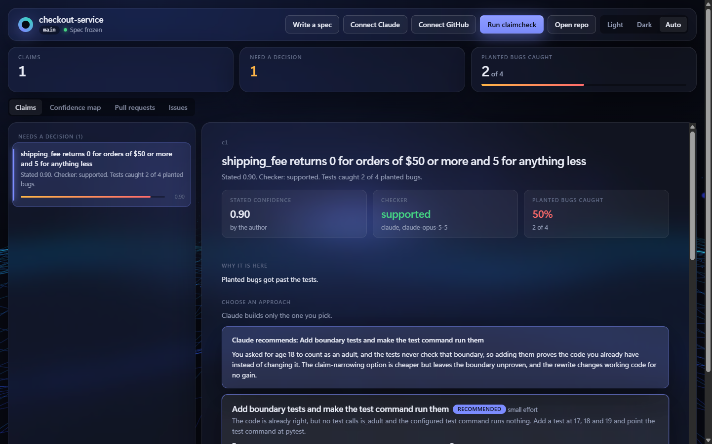

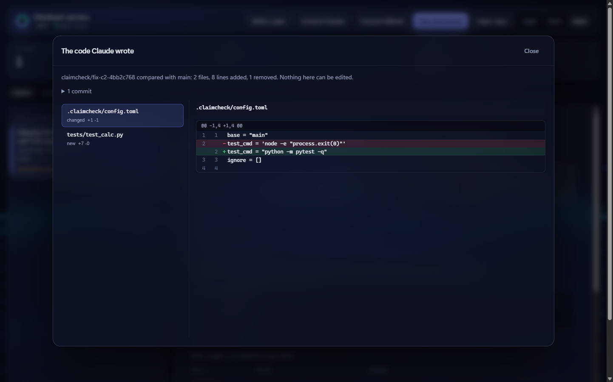

When no claim needs a decision, a banner says so and offers **Open pull request**. The banner says plainly that "backed" is a good sign, not a sign-off.

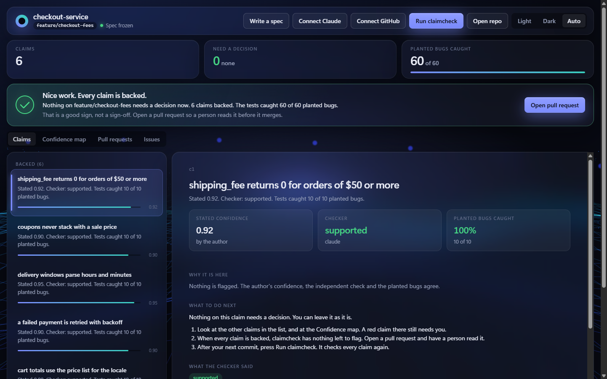

Before anything runs, Desk lists the commands the repo would run and waits for your OK. **Connect GitHub** checks that the GitHub CLI, `gh`, is signed in. **Open repo** takes any git repository on the computer.

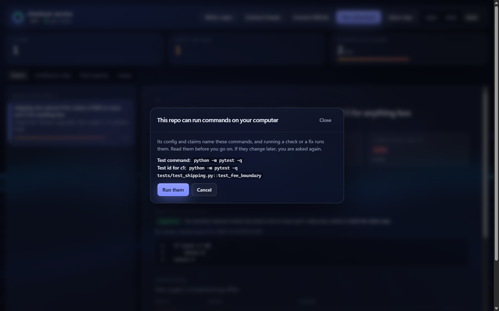

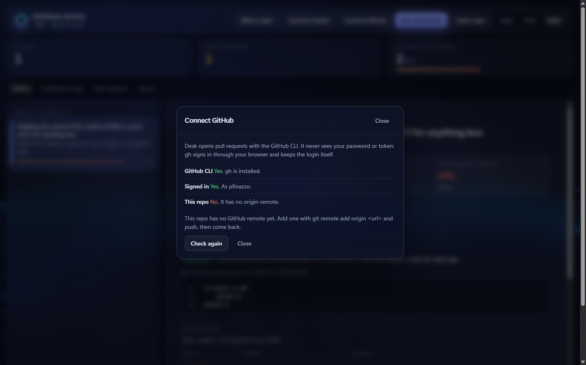

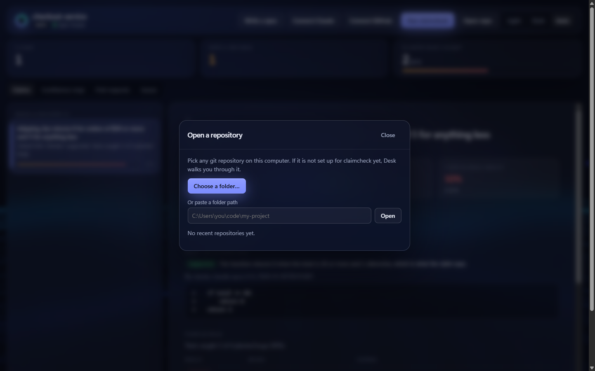

### Pull requests and issues

Desk reads the open pull requests and issues of the repo on GitHub, through the GitHub CLI. So it works on any repo that has a GitHub remote, whether or not that repo uses claimcheck yet. For each pull request, Desk shows:

- its checks and review state,
- whether it can merge,
- the issues it closes,
- its files,
- its description, drawn as Markdown.

Nothing is written to GitHub unless you press a button that says so.

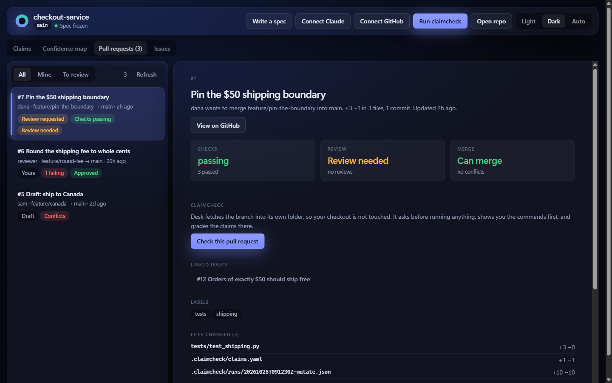

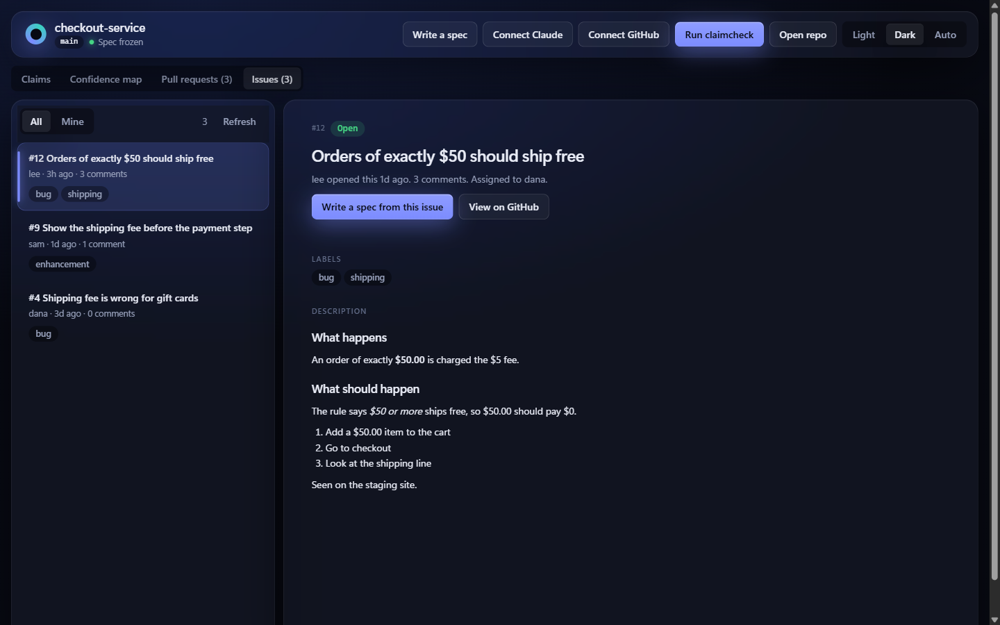

When a pull request's branch has claims, **Check this pull request** checks them:

- It fetches the branch into a folder of its own, so your own checkout is never touched. It checks the claims there.
- It lists the commands first, and runs nothing until you agree.
- When the base branch has claimcheck settings, it uses those. So a pull request cannot loosen its own checks.
- **Post results** shows the exact comment first. It posts it only when you press Post comment.

An issue has a **Write a spec from this issue** button.

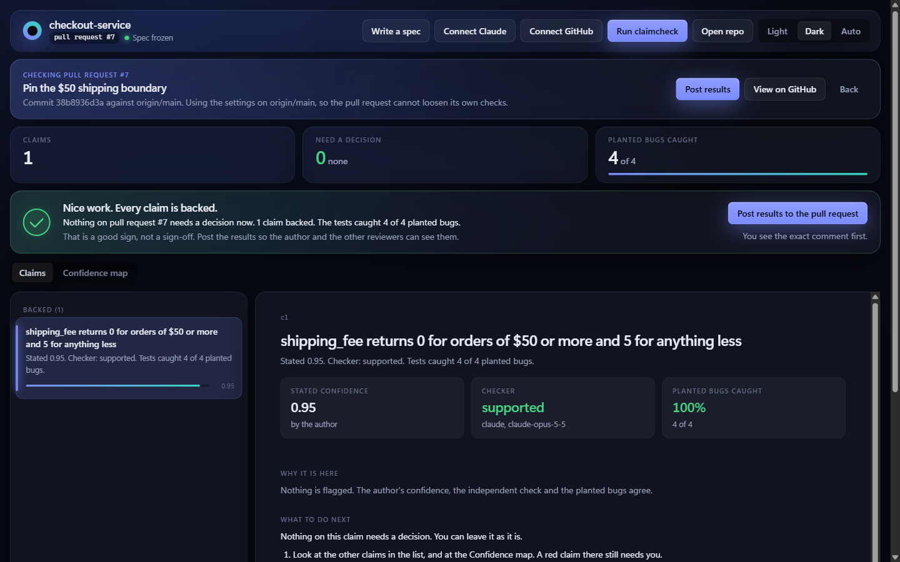

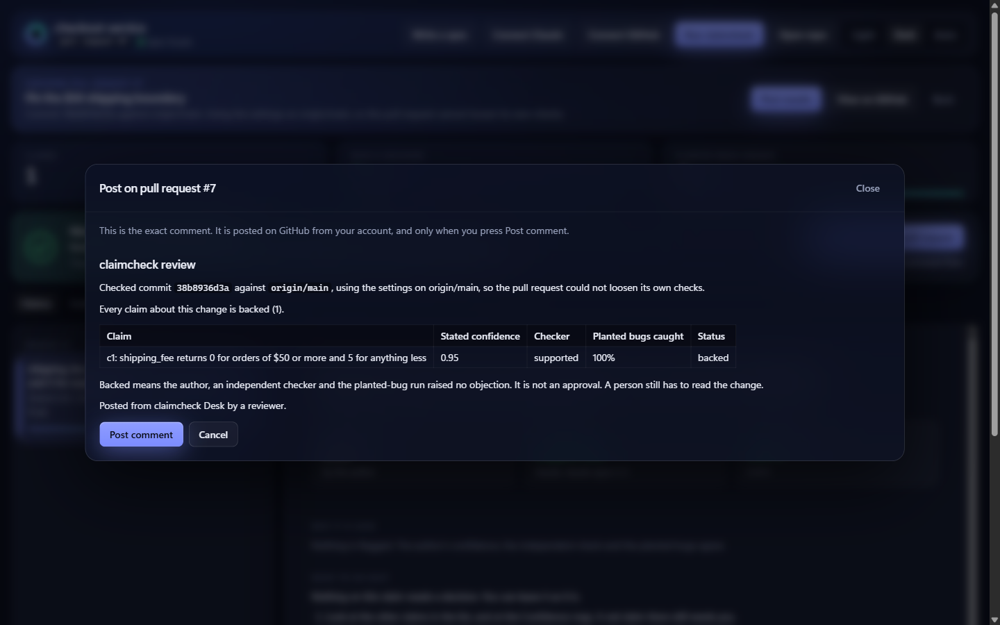

### Reading the confidence map

Desk has a second tab next to the list, called **Confidence map**. It shows every claim at once: the ones that passed and the ones that did not. Each claim is one ball inside a see-through box. Where a ball sits tells you how far to trust that claim.

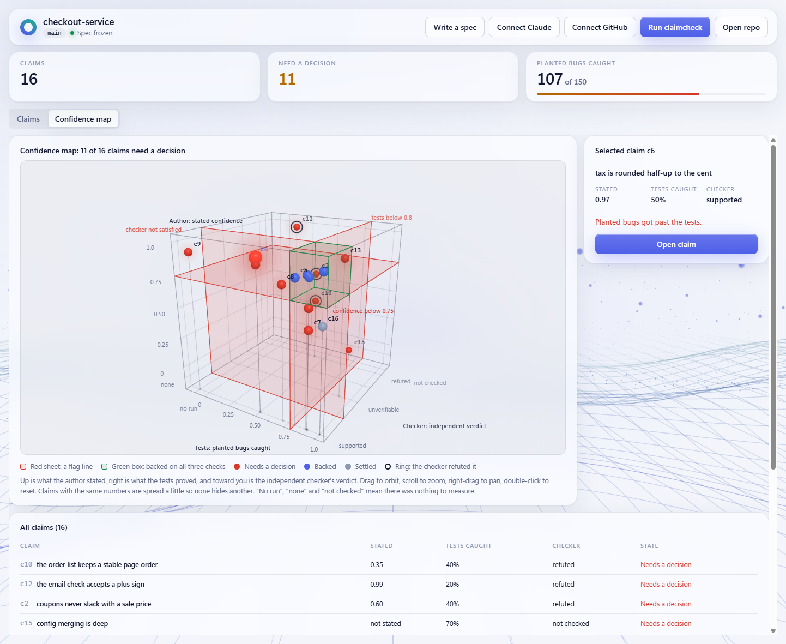

*The same sample data in light mode.*

#### What the three directions mean

The box asks three questions about every claim. A ball's position answers all three at once.

| Direction | The question | What the number is | The good end |
| --- | --- | --- | --- |
| **Up** | How sure was the AI that wrote the code? | The confidence it stated, from 0 to 1. | The top |
| **Right** | Would your tests catch a mistake? | The catch rate. claimcheck plants small bugs in the new code and reruns your tests. This is the share of those bugs your tests noticed, from 0 (none) to 1.0 (all). | The right |
| **Toward you** | Did a second AI agree? | The checker's verdict: refuted, unverifiable or supported. | The side nearest you when the map opens, which is supported |

The best place for a ball is high, far to the right and near you. That is a claim the AI was sure about, your tests back up, and the checker agreed with.

The labels along the edges of the box show which way is which, even after you turn it.

#### What the colors and shapes mean

- A **red ball** needs a decision from you.
- A **blue ball** is backed. Nothing about it is flagged.
- A **grey ball** is settled. You fixed it, or you accepted the risk.
- A **ring** around a ball means the checker said the claim is false.
- A thin **line down to the floor** has no meaning of its own. It only helps you see where the ball is.

#### The red sheets and the green box

Three red sheets cut through the box. Each one is a warning line. A ball on the wrong side of a sheet gets flagged.

| Red sheet | A claim is flagged when it is | In plain words |
| --- | --- | --- |
| **Confidence below 0.75** | Below the sheet | The AI was not sure about its own claim, or gave no number at all. |
| **Tests below 0.8** | To the left of the sheet | Your tests missed more than 2 of every 10 planted bugs, or no planted-bug run covers the claim yet. |
| **Checker not satisfied** | On the far side of the sheet | The checker did not say "supported". It said refuted or unverifiable, or nobody has run the check yet. |

The small **green box** is the good corner: sure enough, well tested and confirmed by the checker.

- A ball outside the green box has at least one warning.
- A red ball still needs a decision.
- A grey ball had a warning that you have already dealt with.

The first two warning lines are settings. The defaults are below. You can change them in `.claimcheck/config.toml`. Desk reads these settings, and the command line ignores them. The checker's sheet has no setting.

```toml
[app]
flagConfidence = 0.75
flagCatchRate = 0.8
```

#### How to read it in ten seconds

1. Find the green box. Balls inside it are fine.
2. Look at the red balls. Each one needs a decision.
3. Look hardest at red balls that are **high and on the left**. The AI was very sure, and the tests are weak. In the picture, claim c6 states 0.97 confidence, but the tests caught only half of the planted bugs. This is the kind of claim claimcheck exists to find.
4. A red ball that is **low** is a claim the AI itself doubted. It is telling you where it is unsure.
5. A **ring** means the checker disagrees with the claim. Open the claim to read why.

#### The strips at the edge: when nothing was measured

Some claims have nothing to measure in one direction. They sit in a thin strip just outside the box on that side.

- **no run**, on the tests side: no planted-bug run covers this claim yet.
- **none**, on the confidence side: the author gave no confidence.
- **not checked**, on the checker side: the checker has not looked at this claim yet.

A ball in a strip does not mean zero. It means nobody has measured that yet. Press **Run claimcheck** to fill it in.

#### Moving around and getting details

- **Drag** to turn the box. **Scroll** to zoom. **Right-drag** to slide it. **Double-click** to go back to the start. The box turns slowly by itself until you touch it.
- **Hover** over a ball to read its claim.
- **Click** a ball to select it. The card on the right shows its numbers. **Open claim** takes you to the full page for that claim.
- The table under the chart lists every claim with its exact numbers in words, riskiest first.
- Balls with the same numbers are moved apart a little, so that none hides another. The table has the true numbers.
- If your computer cannot draw 3D graphics, Desk shows the table on its own and says so.

How Desk keeps your secrets and your computer safe:

- Desk reads your Claude Code sign-in, or an API key that your operating system stores encrypted.
- Before anything goes to Claude, Desk applies the same secret filter as the command line.
- When Desk uses Claude Code, it stops Claude Code's file tools from reading credential files. It also blocks `cat`, `grep`, `curl`, `git push` and package installs.
- The first run in a repository shows the exact commands that the repo's settings and claims name, and asks before running them.
- The page is built without `innerHTML`. So text from a repository can never turn into page markup.

## Writing good claims

A claim is one sentence about the diff that could turn out to be false. Your coding AI writes the claims, following the rules `init` added to its instructions. It still helps to know what makes a good one:

- **One checkable statement per claim.** "`shipping_fee` returns 0 at exactly $50" is a claim. "The shipping feature works" is not.
- **Name what it is about.** List the numbers of the criteria it supports, and every file it is about.
- **State real confidence.** If the code was never run, 0.6 is better than 0.95.
- **Give a `kill_condition`.** That is the check that would show the claim is false. It takes one of three forms:
  - `test:` names a test. If that test fails, the claim is wrong.
  - `cmd:` names a command. If that command fails, the claim is wrong.
  - `obs:` describes something a person could look at, such as a value in a log or on screen. If it is not what the claim says, the claim is wrong.

  claimcheck never runs the test or command. Instead, the checker reads the changed code and judges whether that check would fail. If the code plainly breaks it, the checker marks the claim refuted.

  The kill condition must name a separate check. If it just copies the claim's own sentence, `claimcheck claims validate` rejects the claims file.

```yaml
version: 1
author: "claude-code"
base: "main"
claims:
  - id: c1
    claim: "shipping_fee returns 0 for orders of $50 or more and 5 for anything under"
    confidence: 0.92
    criteria: [1, 2, 3]
    files: ["src/shipping.py"]
    kill_condition: "test: tests/test_shipping.py::test_exactly_fifty_ships_free"
    verified_by:
      - "cmd: python -m pytest -q"
```

claimcheck's validator rejects a claims file with exit code 4 when it finds any of these:

- an `id` that is not lowercase letters, digits, `-` or `_`,
- empty claim text,
- a confidence outside 0 to 1,
- a bad `kill_condition`,
- an empty `verified_by` or `files`,
- a field of the wrong type,
- criteria numbers that are not in the frozen lock.

The commit hook has three rules for every commit that changes code:

- The same commit must update `claims.yaml`.
- Every file a claim lists must be in that commit.
- Every changed code file must be covered by some claim.

Deletions count as changes. `run` and `check` apply the same rules to the whole diff. So skipping the hook does not skip the rules.

## Reference

### Commands

```
claimcheck init                    guided setup: secrets, config, hook, .gitignore, agent notes, first spec
claimcheck status [--json]         where this repo is: set up, spec state, hook, branch
claimcheck spec draft              write the spec as a conversation with Claude
claimcheck spec freeze             hash the criteria into spec.lock
claimcheck spec verify             refuse if the spec drifted from the lock
claimcheck claims validate [path]  schema-check a claims file against the frozen criteria
claimcheck check                   independent verdict per claim
claimcheck mutate                  planted-bug catch rate on the changed lines
claimcheck run                     verify, validate, check, mutate, then append to the ledger
claimcheck accept ID --note TEXT   for a person: let through a claim the checker could not settle
claimcheck verify-ledger [--base REF]  fail if a ledger line was removed, edited, moved or inserted
claimcheck hook pre-commit         what the installed git hook runs
```

`check`, `mutate` and `run` share these options:

| Option | Meaning |
| --- | --- |
| `--base REF` | The git branch or commit the diff is measured against. The default is `base` in the settings file |
| `--worktree` | Check changes you have not committed yet, including new files git does not track. Without it, claimcheck checks the commits on your branch since it left the base, which git writes as `base...HEAD` |
| `--provider auto\|claude\|claude-cli\|openai\|stub` | How to reach the AI model (`check` and `run`) |
| `--model NAME` | The checker's model (`check` and `run`) |
| `--test-cmd CMD` | Use a different test command (`mutate` and `run`) |
| `--max-mutants N` | Plant at most N bugs (`mutate` and `run`) |
| `--seed N` | Pick the same sample of planted bugs every time |
| `--restore` | After a `mutate` that crashed, put backed-up files back. See Troubleshooting |

`check`, `mutate` and `run` print one JSON document to standard output, and save it under `.claimcheck/runs/`. Messages meant for people go to standard error. Four modes meant for other programs also print JSON: `init --json`, `status --json`, `spec draft --step` and `spec draft --finish`. When they fail, they print `{"error": "...", "code": N}` and exit with that code.

### Providers

A provider is how claimcheck reaches an AI model.

| Name | Uses |
| --- | --- |
| `auto` (default) | `ANTHROPIC_API_KEY` if it is set. Otherwise, your Claude Code sign-in |
| `claude` | The Anthropic API, through Anthropic's official SDK. Needs `claimcheck[claude]` and `ANTHROPIC_API_KEY` |
| `claude-cli` | Your Claude Code sign-in, through the `claude` command, with all of its tools off. No API key needed |
| `openai` | Any server that works like OpenAI's: OpenAI itself, or one on your own computer such as Ollama. `auto` never picks it. See below |
| `stub` | Offline, and gives the same answer every time. Every claim comes back unverifiable, and the spec conversation gives placeholder questions. Good for trying the planted-bug half |

#### Using a model other than Claude

The `openai` provider sends each request to a server that offers OpenAI's chat completions API. It needs no extra package. Three environment variables set it up:

| Variable | Meaning |
| --- | --- |
| `OPENAI_BASE_URL` | The server's address, up to and including `/v1`. The default is `https://api.openai.com/v1` |
| `OPENAI_API_KEY` | The key the server wants, sent as a bearer token. Leave it unset for a local server that needs no key |
| `OPENAI_MODEL` | The model to ask when no other model is given. `spec draft` always uses it |

For `check` and `run`, claimcheck picks the model like this:

- If you pass `--model`, it uses that.
- Otherwise, it uses `model` under `[checker]` in `.claimcheck/config.toml`.

So change both of these lines together:

```toml
[checker]
provider = "openai"
model = "qwen2.5:7b"
```

To use a model on your own computer with [Ollama](https://ollama.com):

```bash
ollama pull qwen2.5:7b
export OPENAI_BASE_URL=http://localhost:11434/v1
export OPENAI_MODEL=qwen2.5:7b
claimcheck spec draft --provider openai
claimcheck run --provider openai --model qwen2.5:7b
```

To use OpenAI itself: set `OPENAI_API_KEY`, leave `OPENAI_BASE_URL` unset, and name a model your account can use.

How claimcheck asks the server:

- Each request carries the shape of the JSON answer it wants, as `response_format`. The message also repeats that shape as text. Some servers ignore `response_format`, so the text is the backup.
- If the answer comes wrapped in a Markdown code block, claimcheck unwraps it.
- Each call is one request, with a 300-second time limit. When an answer is unusable, the checker already asks once more.
- The same secret filter as with Claude runs on every request. [What is sent to Claude](#what-is-sent-to-claude) applies to this server too.

If something goes wrong, the error says what to check:

- the server is not running,
- the key was refused (401 or 403),
- the address or model name is wrong (404),
- or the account is rate limited (429).

A small model on your own computer is a weaker checker than Claude. It may answer unverifiable more often, or miss a contradiction. The planted-bug half does not use a model, so it stays just as strong.

The Desk app still connects to Claude only. Use the command line for any other provider.

### Exit codes

An exit code is the number a command returns when it ends. Scripts and CI use it to tell what happened.

| Code | Meaning |
| --- | --- |
| 0 | OK |
| 1 | Some other error, including a setting with a bad value |
| 2 | A claim was refuted, or the catch rate is under `min_catch_rate` |
| 3 | The spec was refused: it no longer matches its lock, it was frozen again after code changed, or the base branch does not exist |
| 4 | The claims file is invalid, or the pre-commit hook rejected the commit |
| 5 | A problem with the provider, an unknown provider, your tests fail before any bug is planted, or your files no longer match the diff |
| 6 | An earlier `mutate` left its lock file behind, or `--restore` refused to overwrite a file |
| 7 | The diff is empty, so there is nothing to check. Commit the change, or pass `--worktree` |
| 8 | `verify-ledger` found a ledger line that was removed, edited, moved or inserted |
| 9 | A claim needs a person: the checker found it unverifiable, and no matching `claimcheck accept` lets it through. When a run has reasons for both 2 and 9, it exits with 2 |

### Files

| File | Purpose |
| --- | --- |
| `.claimcheck/spec.md` | The acceptance criteria, as `- [ ] 1. text` lines |
| `.claimcheck/spec.lock` | JSON with a hash for each criterion and the time it was frozen. Before hashing, line endings are made uniform and any BOM is removed. A BOM is an invisible marker some editors put at the start of a file. So Windows and Linux get the same hash |
| `.claimcheck/claims.yaml` | One entry per claim. See [`examples/claims.yaml`](examples/claims.yaml) |
| `.claimcheck/ledger.jsonl` | The permanent record. Lines are only ever added. Each new line carries `prev`, a SHA-256 hash (a standard kind of fingerprint) of the line before it, and `claimcheck verify-ledger` checks that chain. Lines written before the chain existed are sealed by the first chained line. See [`examples/ledger.jsonl`](examples/ledger.jsonl) |
| `.claimcheck/config.toml` | Settings. See [`examples/config.toml`](examples/config.toml) |
| `.claimcheck/setup.json` | The files `init` changed outside `.claimcheck/`, so the first commit includes them |
| `.claimcheck/tasks/<task>/` | In the tasks layout: that task's own `spec.md`, `spec.lock`, `claims.yaml` and `ledger.jsonl`. See [Using it on a team](#using-it-on-a-team) |

### Config

`init` writes this file with your detected test command and ignore list. If a setting has a value of the wrong type, claimcheck reports it by name instead of quietly ignoring it.

```toml
version = 1
base = "main"                       # the ref diffs are measured against
layout = "tasks"                    # one folder per task; "single" (the default) = one set for the repo
test_cmd = "npm test"               # rerun once per planted bug
ignore = ["*.md", "docs/**", ".claimcheck/**", "*.lock", ".gitignore", ".github/**", "tests/**"]
require_full_coverage = true        # the hook rejects uncovered code files (false = warn)

[checker]
provider = "auto"                   # "auto" | "claude" | "claude-cli" | "openai" | "stub"
model = "claude-opus-5-5"
fail_on_unverifiable = true         # an UNVERIFIABLE no person accepted exits 9 (false = warn)

[mutate]
max_mutants = 50
timeout_s = 600                     # per test run; the whole process tree is killed on timeout
min_catch_rate = 0.0                # 0.0 reports only; raise it to gate
```

In `ignore`, both `*` and `**` match across folders. A pattern that starts with `**/` also matches at the top level.

### The four kinds of planted bug

Planted bugs are made by editing the text of a line, so they work in any programming language. They go only into lines the diff adds, and never inside quoted strings.

| Kind | Example |
| --- | --- |
| Sign flip | `a + b` becomes `a - b`, and a minus sign in front of a value is dropped |
| Off by one | `50` becomes `51` |
| Swapped arguments | `f(a, b)` becomes `f(b, a)` |
| Boundary shift | `>=` becomes `>`, and `<` becomes `<=` |

If a planted bug stops the code from building, it counts as caught, because the test command fails.

## Troubleshooting

**`mutate.lock exists: a previous mutate run did not finish`**

`mutate` edits your files while it plants bugs. It puts them back afterwards, even if it fails or you press Ctrl+C. The lock file stays behind only if putting a file back failed. To recover:

1. Run `claimcheck mutate --restore`. It puts a file back only if the file still holds the planted bug. It leaves alone any file you edited since.
2. For each file it left alone, it says which file and why. It keeps the backup in `.claimcheck/mutate-backup/` and exits with code 6.
3. Sort those files out by hand. Then delete `.claimcheck/mutate.lock`.

**`... line 6 no longer matches the diff`**

You edited a file after committing it. Before `mutate` touches anything, it checks every planted bug against the current file. So nothing was changed. Commit or stash your edits and run it again.

**The commit is rejected with "staged paths with no claim covering them"**

A changed file is not listed in any claim's `files`. You have three options: add it to a claim, add it to `ignore` if it is not product code, or set `require_full_coverage = false` to get a warning instead.

**The commit is rejected with "files not in the staged diff"**

A claim lists a file that is not in this commit. Claims describe the diff of one commit.

**`spec drifted from lock` (exit 3)**

`spec.md` no longer matches `spec.lock`.

- If you did not mean to change the spec, run `git checkout .claimcheck/spec.md`.
- If a criterion really was wrong, start a new task on a new branch and freeze again.

**`refusing to re-freeze with an open diff`**

Code has already changed on this branch. Freezing a new spec is allowed only before that. Start the next task on a fresh branch from the base.

**`base ref 'main' was not found`**

The branch named in `config.toml` does not exist in this copy of the repo. That often happens in a shallow CI clone. Fetch it with `git fetch origin main`, correct `base`, or pass `--base origin/main`.

**The baseline tests fail (exit 5)**

claimcheck runs your tests once before it plants anything. If they fail on your unchanged code, there is nothing to measure.

**Part of my diff was withheld from the checker**

That is the secret filter at work. The `sent` section of the check result names the files and counts what was redacted. A file such as `.env` should not be committed at all. `claimcheck init` reports any that are.

**A planted bug survived but is not really a bug**

Some edits do not change what the code does. Take a `clamp` function: `if x < lo` and `if x <= lo` return the same value at the boundary, so no test can tell them apart. Read the bugs your tests missed and judge each one. For the harmless ones, accept the risk with a reason.

**The hook does nothing**

Run `claimcheck status`. `init` installs the hook where git reads it, including with `core.hooksPath` and in worktrees. If you recreate your Python virtual environment, run `claimcheck init` again, so the hook points at the new Python.

**Animations look wrong**

Use `--no-animation`, or set `NO_COLOR=1`. On older Windows consoles, use Windows Terminal, which draws the box lines and colors correctly.

## Limits, stated plainly

- **The checker only sees the diff.** Anything under `.claimcheck/` is removed from it. So the checker never sees your confidence, your evidence or earlier ledger lines. It cannot run your code. A claim that depends on what the code does when it runs comes back unverifiable. That is honest, but it is not a pass: the run exits with code 9 until a person accepts the claim.
- **The catch rate measures your tests, not your code.** A high rate means your tests would notice small breakages in the lines you added. It does not mean the code is right.
- **There are only four kinds of planted bug.** Real bugs are more varied. So the catch rate is a lower bound on how well your tests react, not a full audit.
- **Some planted bugs change nothing.** These are called equivalent mutants. They do not change what the code does, so they always survive. Judge the bugs your tests missed. Do not just count them.
- **Only added lines get planted bugs.** Bugs in existing code that the change relies on are not covered. Files that are not valid UTF-8, the standard text encoding, are skipped, and the skips are counted.
- **The secret filter is a safety net.** See [What is sent to Claude](#what-is-sent-to-claude).
- **The ledger shows tampering, but cannot prevent it.**
  - The hash chain catches a line that was removed from the middle, edited, moved or inserted.
  - It cannot see the last line being cut off. So CI also runs `verify-ledger --base`. That requires the base branch's ledger to be an unchanged beginning of yours.
  - Someone who can write to the whole file can still rewrite every line and recompute the chain. Nothing here signs the ledger. The protection is that such a rewrite shows up in the git history.
- **Confidence is not calibrated yet.** Version 1 makes sure the data exists. A chart of stated confidence against real outcomes comes once the ledger holds real outcomes.
- **The spec is only as good as the person who wrote it.** claimcheck proves that the code matches the frozen spec, and that the spec was not bent afterwards. It cannot tell you the spec was the right one.
- **The animated setup is checked by tests and by rendered frames, not in every terminal.** If something looks wrong in yours, `--no-animation` gives the plain flow.

## Development

```bash
python -m venv .venv
.venv/Scripts/activate          # on macOS and Linux: source .venv/bin/activate
pip install -e ".[dev,claude]"
ruff check                      # lint: the coding conventions a linter can check
mypy                            # type check of src/ and tests/
pytest                          # about 380 tests, around 100 seconds

cd app
npm install
npm run lint                    # ESLint with the same conventions
npm test                        # type checks, lints, builds, then about 90 tests
npm run build                   # bundles the main process, the preload and the page into dist/
```

Desk is written entirely in TypeScript, in strict mode, with no `any`. A test fails if any hand-written JavaScript appears.

The repo's rules for coding AIs live in `CLAUDE.md`, which Claude Code reads. `AGENTS.md` is a word-for-word copy for AIs that read that file instead, such as OpenAI's Codex. Edit both, or a test fails.

```
src/claimcheck/   the CLI: init flow, onboarding, spec conversation, checker, mutate, ledger, hook, redaction, providers
tests/            Python tests; fixtures/secret_cases.json is shared with the Desk tests
app/              the Desk Electron app
examples/         a sample spec, claims file, config and ledger
docs/screenshots/ images used in this README
```

Where the README's images come from:

- The terminal screens are real frames from the setup tour, drawn as images.
- The Desk images come from the app's own `npm run screenshot` command, using a small demo project.
- The confidence map images use sample claims for a made-up checkout service. They were drawn with `npm run screenshot -- <repo> out.png --view board:graph`.

## Credit and prior art

Patrick Finazzo designed and built claimcheck. The design is the combination of five parts:

- acceptance criteria frozen before the code is written, and checked against a lock,
- claims that carry a stated confidence and a kill condition,
- a checker that never sees the confidence,
- planted bugs that measure whether the tests would notice,
- and a ledger that is only ever added to, which lets you compare confidence against real outcomes over time.

Each part has a history, and it is worth saying so. Planting bugs to test the tests is called mutation testing. It is decades old, with tools such as Stryker, PIT and mutmut. Other tools hash a spec and flag changes to it, or run an independent check against an AI's claims. FleetProof and FalseGreen are two examples. I found no tool that puts these pieces together around AI-written changes, with calibration tracked in a ledger. But I only searched in October 2026, and I may have missed one.

If you use claimcheck or build on its design, please cite it using [CITATION.cff](CITATION.cff). GitHub shows that file as "Cite this repository".

## License

MIT. See [LICENSE](LICENSE). The license requires the copyright notice, "Copyright (c) 2026 Patrick Finazzo", to stay in every copy and substantial portion of the code.
