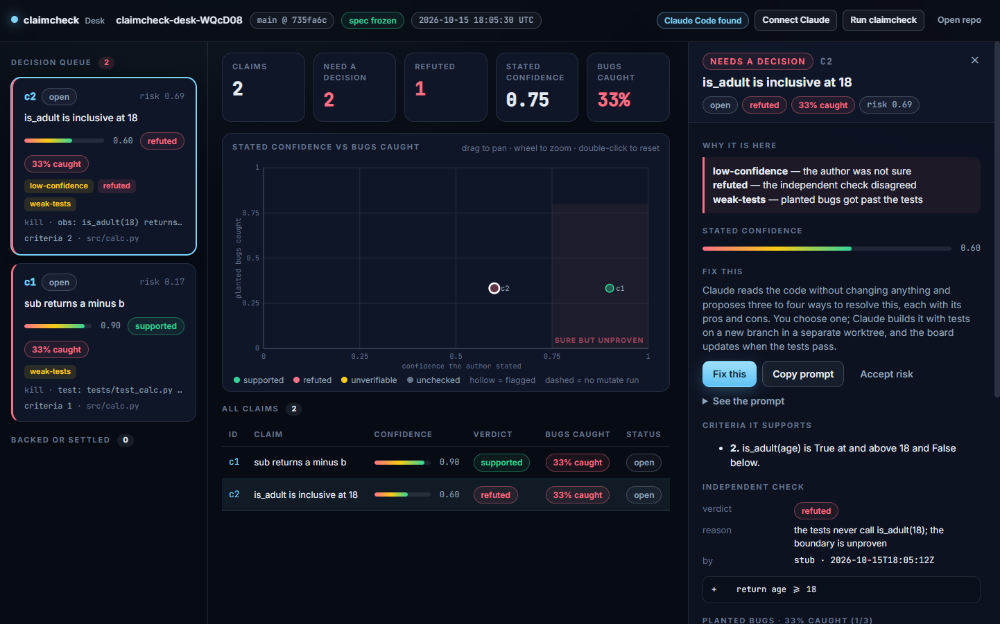

# claimcheck Desk

@author Patrick Finazzo

The desktop board over a claimcheck ledger. Open a repo that has a `.claimcheck/` folder and
see every claim the AI made about its diffs, with the independent verdict and the planted-bug
catch rate beside the confidence it stated. The weak spots land in a decision queue. From any
of them you can press **Fix this** and get three to four genuinely different ways to resolve
it, each with pros and cons, choose one, and watch the board go green when the tests pass.



## Run it

```bash
cd claimcheck/app
npm install
npm start
```

Node 20 or newer. The first install downloads Electron.

## Connect Claude

Two ways, picked in **Connect Claude**:

- **Claude Code CLI.** Uses your own sign-in. Press *Detect* to find `claude`, *Test* to prove
  it answers, *Sign in* to open a terminal running `claude auth login --claudeai`. Proposals run
  with read-only tools. Builds run in a separate git worktree with a tool allowlist and a
  blocklist that keeps Claude off `git push`, `gh`, `curl`, the web, and package installs.
- **API key.** Pasted once, encrypted with your operating system's keychain through Electron's
  `safeStorage`, never written in plain text, never shown again. The screen says only
  `key saved · ends in ····xxxx`. API mode can propose fixes (the app inlines the diff and the
  tests for it) but cannot edit your repo; it gives you the build prompt to paste into Claude
  Code instead.

The app never reads `.env` files.

## The fix flow

1. **Propose.** Claude reads the code and proposes three to four approaches: fix the code, tighten
   the tests, narrow the claim, or replace a kill condition that was not a real observable. Each
   has pros, cons, effort and the files it touches.
2. **Use this approach.** A new branch `claimcheck/fix-<claim>-<id>` in a worktree under
   `.claimcheck/worktrees/`. Claude writes a failing test first, then the fix, then commits.
   It cannot push.
3. **Verify.** The app runs the project's test command in the worktree, then the claim's kill
   condition when it is a command or a test id.
4. **Resolve.** On green the card flips, the panel shows what the issue was and what proves it
   now, an `outcome` line goes on the ledger (`broken`, `fix_commit`), and *Open pull request*
   lights up if `gh` is signed in. On red the run stays visible with the output tail and the
   worktree is kept.

**Copy prompt** gives the same request as text, opening with the repository and where it is on
this computer, so it works in any fresh Claude Code session. **Accept risk** takes a one-line
reason, writes a `held` / `human` outcome, and moves the claim out of the queue.

## The four statuses

| status | meaning |
| --- | --- |
| open | flagged or not, nobody has acted on it |
| fixing | a build is running or failed; the worktree exists |
| resolved | tests pass on a fix branch; ledger has the outcome |
| accepted | a person took the risk and said why |

## What it never does

Push, merge, open a PR without you pressing the button, run Claude with MCP servers, run
Claude with tools outside the allowlist, read `.env`, store a key in plain text, or edit the
CLI's own files (`spec.md`, `spec.lock`, `claims.yaml`, run files). It writes only
`.claimcheck/app-state.json`, `.claimcheck/worktrees/`, and `outcome` lines on the ledger.

## Verify it

```bash
npm test                                  # node --test over lib/ and the renderer's pure functions
npm run screenshot -- <repo> board.png    # launches headless, renders the board, writes a PNG
```
